``` r
#global settings for figures
knitr::opts_chunk$set(echo = TRUE, dev = "png", dpi = 300, fig.keep = "all", fig.path ="./03_FIGURES/")
```

# CellChat v2 : From Ligand-Receptor interactions to Comparative Cell-Cell Communication Networks

**This tutorial aims to provide a step by step introduction to CellChat v2 (an R package) designed to infer and visualize cell-cell communication networks form scRNA-seq data.**

-   **Link to CellChat Git repository :** <https://github.com/jinworks/CellChat/tree/main>
-   **Link to the dataset used in this tutorial :** <https://ndownloader.figshare.com/files/25950872>
-   **CellChat v2 bibliography :** Jin, S., Plikus, M. V., & Nie, Q. (2025). CellChat for systematic analysis of cell–cell communication from single-cell transcriptomics. Nature Protocols, 20(1), 180‑219. <https://doi.org/10.1038/s41596-024-01045-4>
-   **CellChat v1 bibliography :** Jin, S., Guerrero-Juarez, C. F., Zhang, L., Chang, I., Ramos, R., Kuan, C.-H., Myung, P., Plikus, M. V., & Nie, Q. (2021). Inference and analysis of cell-cell communication using CellChat. Nature Communications, 12(1), 1088. <https://doi.org/10.1038/s41467-021-21246-9>

All-along this tutorial, we use a publicly available human skin scRNA-seq dataset provided by the CellChat developers and referenced in the official CellChat GitHub repository. The dataset includes two conditions : non-lesional (NL) and lesional (LS) skin, allowing us to investigate how inferred communication networks may differ between biological conditions.

The dataset has already undergone preprocessing, normalization, clustering, and cell-type annotation. Therefore, the upstream steps are not repeated here because this tutorial is focusing specifically on CellChat.

NB : CellChat infers potential interactions based on gene expression and prior knowledge of ligand-receptor relationships. Any prediction does not constitute direct evidence of cell-cell communication.

**The workflow is divided into two main parts :**

**Part 1 - Core CellChat workflow**

Using the nonlesional (NL) skin sub-dataset, we will :

1.  Loading Libraries + Dataset
2.  Creating a CellChat object
3.  Selecting appropriate CellChatDB
4.  Identifying overexpressed signaling genes and interactions
5.  Computing cell-cell communication probabilities
6.  Inferring signaling pathways and aggregating communication networks
7.  Visualizing and interpreting communication networks
8.  Exploring Signaling Roles and Saving Results

**Part 2 - Going further : comparative analysis between two conditions**

Using the lesion (LS) skin sub-dataset, we will extend our analysis :

1.  CellChat analysis of lesional skin
2.  Merging the lesional and nonlesional CellChat objects
3.  Comparing the number and strength of interactions
4.  Identifying differences in signaling pathways between conditions
5.  Interpret condition-specific communication patterns and discuss limitations

------------------------------------------------------------------------

Before going any further, please install the necessary packages if needed.


``` r
#install.packages('devtools')
#devtools::install_github("jinworks/CellChat")
```

# Part 1 - Core CellChat workflow

## Step 1 : Libraries + Dataset Loading

### (A) Libraries import


``` r
#Import the required libraries
library(CellChat)
library(ggplot2)
library(patchwork)
options(stringsAsFactors = FALSE)
```

### (B) Create directories (optional)

To keep the analysis reproductible and organized, we create separate directory and use relative paths.


``` r
#Create directories if they do not exist
dir.create("01_DATA")
dir.create("02_RESULTS")
dir.create("03_FIGURES")
```

### (C) Dataset Loading

The human skin scRNA-seq dataset is provided as an R data file (.rda). For reproducibility concerns, the dataset is download from its original source if the file is not previously available locally.


``` r
#Official CellChat human skin dataset
data_url <- paste("https://ndownloader.figshare.com/files/25950872")
data_file <- "./01_DATA/data_humanSkin_CellChat.rda"

#Download if dataset not available locally
if (!file.exists(data_file))
  download.file(url = data_url, destfile = data_file, mode = "wb")

#Load dataset into R
load(data_file)

#Inspect dataset
names(data_humanSkin)
```

```
## [1] "data" "meta"
```

NB : CellChat can also be initialized from other single-cell data structures such as Seurat object, SingleCellExperiment objects and AnnData object. The input format does not change the main objective of the analysis. For further details, please refer to the official CellChat GitHub repository and documentary (tutorials / QNA).

### (D) Extract normalized expression dataset, metadata and nonlesional (NL) subset

CellChat requires two main inputs :

1.  Normalized gene expression matrix

This matrix contains genes in rows and cells in columns. Each value represents the normalized expression level of a gene in a specific cell.

2.  Cell metadata

It contains information associated with each cell such as annotated cell population and biological condition. In this dataset, there are two important metadata columns : condition (NL or LS) and labels (indicates the annotated cell population).

NB : The expression matrix and metadate must refer to the same cells, in the same order. We use the `stopifnot(identical(..))`function to assess this before going further.


``` r
#Extract normalized expression dataset and metadata
data.input = data_humanSkin$data
meta = data_humanSkin$meta

#Inspect biological conditions : NL and LS
table(meta$condition)
```

```
## 
##   LS   NL 
## 5011 2552
```

``` r
#Select subset with nonlesional cells for CellChat analysis
cell.use = rownames(meta)[meta$condition == "NL"]

#Subset expression matrix and metadata
data.input.NL = data.input[, cell.use]
meta.NL = meta[cell.use, ]

#Verifying matching cell identifier
stopifnot(identical(colnames(data.input.NL), rownames(meta.NL)))
```

***Output interpretation***

As we can see, the whole dataset contains 5011 cells form lesional skin (LS) and 2552 cells from nonlesional skin (NL).

### (E) Explore cell populations and verify data consistency

Here, we examine the number of cells contained in each population.


``` r
#Inspect dimensionality and cell populations
dim(data.input.NL) #matrix dimensions
```

```
## [1] 17328  2552
```

``` r
table(meta.NL$labels) #cell population sizes
```

```
## 
##    APOE+ FIB    FBN1+ FIB COL11A1+ FIB  Inflam. FIB         cDC1         cDC2 
##         1215          548          196           69            7           38 
##           LC   Inflam. DC           TC   Inflam. TC   CD40LG+ TC          NKT 
##           20            1          212           44          166           36
```

***Output interpretation***

The NL subset expression matrix contains 17 328 genes (rows) and 2 552 cells (columns).

The NL cells are assigned to 12 annotated populations such as fibroblasts, T cells, dendritic cells and other immune populations.

The cell populations are not equally represented : APOE+ fibroblasts account for 1 215 cells while the inflammatory dendritic cell population only account for one cell and cDC1 account for 7 cells.

This is important as CellChat estimates communication at the cell group level. Therefore, groups containing very small amount of cells may provide unreliable estimates of ligand and receptor expression. The `filterCommunication()` function will later allow us apply a minimum cell number threshold.

**End of Step 1**

At this stage, we have :

-   Loaded the official human skin scRNA-seq dataset,

-   Identified the available biological conditions (NL/LS),

-   Extracted the NL cells,

-   Checked the expression data and cell metadata.

Now, we can move to Step 2 : Creating a CellChat object.

## Step 2 : Creating a CellChat object

We initialize a CellChat object using the normalized gene expression matrix and corresponding cell metadata.

The `createCellChat()` function organizes the input data into an object that will store information about cell-cell communication.

Three arguments are important :

-   `object` : the normalized expression matrix,

-   `meta` : the cell metadata,

-   `group.by` : the metadata columns defining the cell populations. We use here `group.by = "labels"` so that individual cells are grouped according to their annotated cell types.


``` r
#Initialization of CellChat object for NL skin
cellchat.NL <- createCellChat(object = data.input.NL, meta = meta.NL, group.by = "labels")
```

```
## [1] "Create a CellChat object from a data matrix"
```

```
## Warning in createCellChat(object = data.input.NL, meta = meta.NL, group.by = "labels"): The 'meta' data does not have a column named `samples`. We now add this column and all cells are assumed to belong to `sample1`!
```

```
## Set cell identities for the new CellChat object 
## The cell groups used for CellChat analysis are  APOE+ FIB, FBN1+ FIB, COL11A1+ FIB, Inflam. FIB, cDC1, cDC2, LC, Inflam. DC, TC, Inflam. TC, CD40LG+ TC, NKT
```

``` r
#Inspect initialized CellChat object
cellchat.NL
```

```
## An object of class CellChat created from a single dataset 
##  17328 genes.
##  2552 cells. 
## CellChat analysis of single cell RNA-seq data!
```

``` r
#Check annotated populations
table(cellchat.NL@idents)
```

```
## 
##    APOE+ FIB    FBN1+ FIB COL11A1+ FIB  Inflam. FIB         cDC1         cDC2 
##         1215          548          196           69            7           38 
##           LC   Inflam. DC           TC   Inflam. TC   CD40LG+ TC          NKT 
##           20            1          212           44          166           36
```

``` r
#Verify total number of cells
stopifnot(ncol(cellchat.NL@data) == 2552)
```

***Output interpretation***

NB : If the metadata do not contain a `samples` column, CellChat will automatically assign all cells to a default sample called `sample1`. In this case, this warning does not prevent the analysis from running as we perform the analysis within a single condition.

**End of Step 2**

At this stage, no cell-cell communication has been infered. We only initialized the data structure (CellChat object) required for further analysis.

## Step 3 : Selecting appropriate CellChatDB

CellChat relies on a curated database "CellChatDB", composed of already-known molecular interactions involved in cell-cell signaling. CellChatDB includes ligands, receptors, multimeric complexes and regulatory cofactors. It allows CellChat to identify biologically plausible interactions between cell population based on their gene expression profiles. Interaction can also be organized into signaling pathways, providing another level of analysis.

CellChatDB have specific databases for several species : `CellChatDB.human`, `CellChatDB.mouse` and `CellChatDB.zebrafish` As our dataset is based on human skin cells, we use `CellChatDB.human`.

### (A) Exploring CellChat human ligand-receptor database


``` r
CellChatDB <- CellChatDB.human #loading human DB

#Database structure
names(CellChatDB)
```

```
## [1] "interaction" "complex"     "cofactor"    "geneInfo"
```

``` r
nrow(CellChatDB$interaction)
```

```
## [1] 3233
```

``` r
head(CellChatDB$interaction)
```

```
##                        interaction_name pathway_name ligand      receptor
## TGFB1_TGFBR1_TGFBR2 TGFB1_TGFBR1_TGFBR2         TGFb  TGFB1     TGFbR1_R2
## TGFB2_TGFBR1_TGFBR2 TGFB2_TGFBR1_TGFBR2         TGFb  TGFB2     TGFbR1_R2
## TGFB3_TGFBR1_TGFBR2 TGFB3_TGFBR1_TGFBR2         TGFb  TGFB3     TGFbR1_R2
## TGFB1_ACVR1B_TGFBR2 TGFB1_ACVR1B_TGFBR2         TGFb  TGFB1 ACVR1B_TGFbR2
## TGFB1_ACVR1C_TGFBR2 TGFB1_ACVR1C_TGFBR2         TGFb  TGFB1 ACVR1C_TGFbR2
## TGFB2_ACVR1B_TGFBR2 TGFB2_ACVR1B_TGFBR2         TGFb  TGFB2 ACVR1B_TGFbR2
##                          agonist      antagonist co_A_receptor
## TGFB1_TGFBR1_TGFBR2 TGFb agonist TGFb antagonist              
## TGFB2_TGFBR1_TGFBR2 TGFb agonist TGFb antagonist              
## TGFB3_TGFBR1_TGFBR2 TGFb agonist TGFb antagonist              
## TGFB1_ACVR1B_TGFBR2 TGFb agonist TGFb antagonist              
## TGFB1_ACVR1C_TGFBR2 TGFb agonist TGFb antagonist              
## TGFB2_ACVR1B_TGFBR2 TGFb agonist TGFb antagonist              
##                                co_I_receptor         annotation
## TGFB1_TGFBR1_TGFBR2 TGFb inhibition receptor Secreted Signaling
## TGFB2_TGFBR1_TGFBR2 TGFb inhibition receptor Secreted Signaling
## TGFB3_TGFBR1_TGFBR2 TGFb inhibition receptor Secreted Signaling
## TGFB1_ACVR1B_TGFBR2 TGFb inhibition receptor Secreted Signaling
## TGFB1_ACVR1C_TGFBR2 TGFb inhibition receptor Secreted Signaling
## TGFB2_ACVR1B_TGFBR2 TGFb inhibition receptor Secreted Signaling
##                          interaction_name_2       evidence is_neurotransmitter
## TGFB1_TGFBR1_TGFBR2 TGFB1 - (TGFBR1+TGFBR2) KEGG: hsa04350               FALSE
## TGFB2_TGFBR1_TGFBR2 TGFB2 - (TGFBR1+TGFBR2) KEGG: hsa04350               FALSE
## TGFB3_TGFBR1_TGFBR2 TGFB3 - (TGFBR1+TGFBR2) KEGG: hsa04350               FALSE
## TGFB1_ACVR1B_TGFBR2 TGFB1 - (ACVR1B+TGFBR2) PMID: 27449815               FALSE
## TGFB1_ACVR1C_TGFBR2 TGFB1 - (ACVR1C+TGFBR2) PMID: 27449815               FALSE
## TGFB2_ACVR1B_TGFBR2 TGFB2 - (ACVR1B+TGFBR2) PMID: 27449815               FALSE
##                     ligand.symbol ligand.family
## TGFB1_TGFBR1_TGFBR2         TGFB1      TGF-beta
## TGFB2_TGFBR1_TGFBR2         TGFB2      TGF-beta
## TGFB3_TGFBR1_TGFBR2         TGFB3      TGF-beta
## TGFB1_ACVR1B_TGFBR2         TGFB1      TGF-beta
## TGFB1_ACVR1C_TGFBR2         TGFB1      TGF-beta
## TGFB2_ACVR1B_TGFBR2         TGFB2      TGF-beta
##                                                         ligand.location
## TGFB1_TGFBR1_TGFBR2 Extracellular matrix, Secreted, Extracellular space
## TGFB2_TGFBR1_TGFBR2 Extracellular matrix, Secreted, Extracellular space
## TGFB3_TGFBR1_TGFBR2 Extracellular matrix, Secreted, Extracellular space
## TGFB1_ACVR1B_TGFBR2 Extracellular matrix, Secreted, Extracellular space
## TGFB1_ACVR1C_TGFBR2 Extracellular matrix, Secreted, Extracellular space
## TGFB2_ACVR1B_TGFBR2 Extracellular matrix, Secreted, Extracellular space
##                                                                                                                                                                                                                                                                                       ligand.keyword
## TGFB1_TGFBR1_TGFBR2                                                                   Disease variant, Signal, Reference proteome, Extracellular matrix, Disulfide bond, Secreted, Mitogen, Growth factor, Direct protein sequencing, Cleavage on pair of basic residues, 3D-structure, Glycoprotein
## TGFB2_TGFBR1_TGFBR2 Disease variant, Chromosomal rearrangement, Signal, Reference proteome, Disulfide bond, Secreted, Extracellular matrix, Mitogen, Growth factor, Direct protein sequencing, 3D-structure, Cleavage on pair of basic residues, Alternative splicing, Aortic aneurysm, Glycoprotein
## TGFB3_TGFBR1_TGFBR2                                           Disease variant, Signal, Reference proteome, Extracellular matrix, Disulfide bond, Secreted, Mitogen, Cardiomyopathy, Growth factor, Cleavage on pair of basic residues, Alternative splicing, 3D-structure, Methylation, Glycoprotein
## TGFB1_ACVR1B_TGFBR2                                                                   Disease variant, Signal, Reference proteome, Extracellular matrix, Disulfide bond, Secreted, Mitogen, Growth factor, Direct protein sequencing, Cleavage on pair of basic residues, 3D-structure, Glycoprotein
## TGFB1_ACVR1C_TGFBR2                                                                   Disease variant, Signal, Reference proteome, Extracellular matrix, Disulfide bond, Secreted, Mitogen, Growth factor, Direct protein sequencing, Cleavage on pair of basic residues, 3D-structure, Glycoprotein
## TGFB2_ACVR1B_TGFBR2 Disease variant, Chromosomal rearrangement, Signal, Reference proteome, Disulfide bond, Secreted, Extracellular matrix, Mitogen, Growth factor, Direct protein sequencing, 3D-structure, Cleavage on pair of basic residues, Alternative splicing, Aortic aneurysm, Glycoprotein
##                       ligand.secreted_type ligand.transmembrane receptor.symbol
## TGFB1_TGFBR1_TGFBR2          growth factor                FALSE  TGFBR2, TGFBR1
## TGFB2_TGFBR1_TGFBR2          growth factor                FALSE  TGFBR2, TGFBR1
## TGFB3_TGFBR1_TGFBR2 cytokine;growth factor                 TRUE  TGFBR2, TGFBR1
## TGFB1_ACVR1B_TGFBR2          growth factor                FALSE  TGFBR2, ACVR1B
## TGFB1_ACVR1C_TGFBR2          growth factor                FALSE  TGFBR2, ACVR1C
## TGFB2_ACVR1B_TGFBR2          growth factor                FALSE  TGFBR2, ACVR1B
##                                                            receptor.family
## TGFB1_TGFBR1_TGFBR2 Protein kinase superfamily, TKL Ser/Thr protein kinase
## TGFB2_TGFBR1_TGFBR2 Protein kinase superfamily, TKL Ser/Thr protein kinase
## TGFB3_TGFBR1_TGFBR2 Protein kinase superfamily, TKL Ser/Thr protein kinase
## TGFB1_ACVR1B_TGFBR2 Protein kinase superfamily, TKL Ser/Thr protein kinase
## TGFB1_ACVR1C_TGFBR2 Protein kinase superfamily, TKL Ser/Thr protein kinase
## TGFB2_ACVR1B_TGFBR2 Protein kinase superfamily, TKL Ser/Thr protein kinase
##                                                                                       receptor.location
## TGFB1_TGFBR1_TGFBR2 Cell membrane, Secreted, Membrane raft, Cell surface, Cell junction, Tight junction
## TGFB2_TGFBR1_TGFBR2 Cell membrane, Secreted, Membrane raft, Cell surface, Cell junction, Tight junction
## TGFB3_TGFBR1_TGFBR2 Cell membrane, Secreted, Membrane raft, Cell surface, Cell junction, Tight junction
## TGFB1_ACVR1B_TGFBR2                                              Cell membrane, Secreted, Membrane raft
## TGFB1_ACVR1C_TGFBR2                                    Cell membrane, Secreted, Membrane raft, Membrane
## TGFB2_ACVR1B_TGFBR2                                              Cell membrane, Secreted, Membrane raft
##                                                                                                                                                                                                                                                                                                                                                                                                                                                                                                                                                                        receptor.keyword
## TGFB1_TGFBR1_TGFBR2 Membrane, Secreted, Disulfide bond, Kinase, Transmembrane, Differentiation, ATP-binding, Receptor, Alternative splicing, Aortic aneurysm, Transferase, Glycoprotein, Manganese, Disease variant, Growth regulation, Signal, Reference proteome, Metal-binding, Transmembrane helix, Hereditary nonpolyposis colorectal cancer, Cell membrane, Phosphoprotein, Direct protein sequencing, Apoptosis, Craniosynostosis, Serine/threonine-protein kinase, 3D-structure, Nucleotide-binding, Magnesium, Tight junction, Isopeptide bond, Cell junction, Ubl conjugation
## TGFB2_TGFBR1_TGFBR2 Membrane, Secreted, Disulfide bond, Kinase, Transmembrane, Differentiation, ATP-binding, Receptor, Alternative splicing, Aortic aneurysm, Transferase, Glycoprotein, Manganese, Disease variant, Growth regulation, Signal, Reference proteome, Metal-binding, Transmembrane helix, Hereditary nonpolyposis colorectal cancer, Cell membrane, Phosphoprotein, Direct protein sequencing, Apoptosis, Craniosynostosis, Serine/threonine-protein kinase, 3D-structure, Nucleotide-binding, Magnesium, Tight junction, Isopeptide bond, Cell junction, Ubl conjugation
## TGFB3_TGFBR1_TGFBR2 Membrane, Secreted, Disulfide bond, Kinase, Transmembrane, Differentiation, ATP-binding, Receptor, Alternative splicing, Aortic aneurysm, Transferase, Glycoprotein, Manganese, Disease variant, Growth regulation, Signal, Reference proteome, Metal-binding, Transmembrane helix, Hereditary nonpolyposis colorectal cancer, Cell membrane, Phosphoprotein, Direct protein sequencing, Apoptosis, Craniosynostosis, Serine/threonine-protein kinase, 3D-structure, Nucleotide-binding, Magnesium, Tight junction, Isopeptide bond, Cell junction, Ubl conjugation
## TGFB1_ACVR1B_TGFBR2                                                 Membrane, Secreted, Disulfide bond, Kinase, Transmembrane, Differentiation, ATP-binding, Receptor, Alternative splicing, Aortic aneurysm, Transferase, Glycoprotein, Manganese, Disease variant, Growth regulation, Signal, Reference proteome, Metal-binding, Transmembrane helix, Hereditary nonpolyposis colorectal cancer, Cell membrane, Phosphoprotein, Direct protein sequencing, Apoptosis, Craniosynostosis, Serine/threonine-protein kinase, 3D-structure, Nucleotide-binding, Magnesium, Ubl conjugation
## TGFB1_ACVR1C_TGFBR2                                                                  Membrane, Secreted, Disulfide bond, Kinase, Transmembrane, Differentiation, ATP-binding, Receptor, Alternative splicing, Aortic aneurysm, Transferase, Glycoprotein, Manganese, Disease variant, Growth regulation, Signal, Reference proteome, Metal-binding, Transmembrane helix, Hereditary nonpolyposis colorectal cancer, Cell membrane, Phosphoprotein, Direct protein sequencing, Apoptosis, Craniosynostosis, Serine/threonine-protein kinase, 3D-structure, Nucleotide-binding, Magnesium
## TGFB2_ACVR1B_TGFBR2                                                 Membrane, Secreted, Disulfide bond, Kinase, Transmembrane, Differentiation, ATP-binding, Receptor, Alternative splicing, Aortic aneurysm, Transferase, Glycoprotein, Manganese, Disease variant, Growth regulation, Signal, Reference proteome, Metal-binding, Transmembrane helix, Hereditary nonpolyposis colorectal cancer, Cell membrane, Phosphoprotein, Direct protein sequencing, Apoptosis, Craniosynostosis, Serine/threonine-protein kinase, 3D-structure, Nucleotide-binding, Magnesium, Ubl conjugation
##                     receptor.surfaceome_main receptor.surfaceome_sub
## TGFB1_TGFBR1_TGFBR2                Receptors         Act.TGFB;Kinase
## TGFB2_TGFBR1_TGFBR2                Receptors         Act.TGFB;Kinase
## TGFB3_TGFBR1_TGFBR2                Receptors         Act.TGFB;Kinase
## TGFB1_ACVR1B_TGFBR2                Receptors         Act.TGFB;Kinase
## TGFB1_ACVR1C_TGFBR2                Receptors         Act.TGFB;Kinase
## TGFB2_ACVR1B_TGFBR2                Receptors         Act.TGFB;Kinase
##                     receptor.adhesome receptor.secreted_type
## TGFB1_TGFBR1_TGFBR2                                         
## TGFB2_TGFBR1_TGFBR2                                         
## TGFB3_TGFBR1_TGFBR2                                         
## TGFB1_ACVR1B_TGFBR2                                         
## TGFB1_ACVR1C_TGFBR2                                         
## TGFB2_ACVR1B_TGFBR2                                         
##                     receptor.transmembrane       version
## TGFB1_TGFBR1_TGFBR2                   TRUE CellChatDB v1
## TGFB2_TGFBR1_TGFBR2                   TRUE CellChatDB v1
## TGFB3_TGFBR1_TGFBR2                   TRUE CellChatDB v1
## TGFB1_ACVR1B_TGFBR2                   TRUE CellChatDB v1
## TGFB1_ACVR1C_TGFBR2                   TRUE CellChatDB v1
## TGFB2_ACVR1B_TGFBR2                   TRUE CellChatDB v1
```

``` r
dplyr::glimpse(CellChatDB$interaction)
```

```
## Rows: 3,233
## Columns: 28
## $ interaction_name         <chr> "TGFB1_TGFBR1_TGFBR2", "TGFB2_TGFBR1_TGFBR2",…
## $ pathway_name             <chr> "TGFb", "TGFb", "TGFb", "TGFb", "TGFb", "TGFb…
## $ ligand                   <chr> "TGFB1", "TGFB2", "TGFB3", "TGFB1", "TGFB1", …
## $ receptor                 <chr> "TGFbR1_R2", "TGFbR1_R2", "TGFbR1_R2", "ACVR1…
## $ agonist                  <chr> "TGFb agonist", "TGFb agonist", "TGFb agonist…
## $ antagonist               <chr> "TGFb antagonist", "TGFb antagonist", "TGFb a…
## $ co_A_receptor            <chr> "", "", "", "", "", "", "", "", "", "", "", "…
## $ co_I_receptor            <chr> "TGFb inhibition receptor", "TGFb inhibition …
## $ annotation               <chr> "Secreted Signaling", "Secreted Signaling", "…
## $ interaction_name_2       <chr> "TGFB1 - (TGFBR1+TGFBR2)", "TGFB2 - (TGFBR1+T…
## $ evidence                 <chr> "KEGG: hsa04350", "KEGG: hsa04350", "KEGG: hs…
## $ is_neurotransmitter      <chr> "FALSE", "FALSE", "FALSE", "FALSE", "FALSE", …
## $ ligand.symbol            <chr> "TGFB1", "TGFB2", "TGFB3", "TGFB1", "TGFB1", …
## $ ligand.family            <chr> "TGF-beta", "TGF-beta", "TGF-beta", "TGF-beta…
## $ ligand.location          <chr> "Extracellular matrix, Secreted, Extracellula…
## $ ligand.keyword           <chr> "Disease variant, Signal, Reference proteome,…
## $ ligand.secreted_type     <chr> "growth factor", "growth factor", "cytokine;g…
## $ ligand.transmembrane     <chr> "FALSE", "FALSE", "TRUE", "FALSE", "FALSE", "…
## $ receptor.symbol          <chr> "TGFBR2, TGFBR1", "TGFBR2, TGFBR1", "TGFBR2, …
## $ receptor.family          <chr> "Protein kinase superfamily, TKL Ser/Thr prot…
## $ receptor.location        <chr> "Cell membrane, Secreted, Membrane raft, Cell…
## $ receptor.keyword         <chr> "Membrane, Secreted, Disulfide bond, Kinase, …
## $ receptor.surfaceome_main <chr> "Receptors", "Receptors", "Receptors", "Recep…
## $ receptor.surfaceome_sub  <chr> "Act.TGFB;Kinase", "Act.TGFB;Kinase", "Act.TG…
## $ receptor.adhesome        <chr> "", "", "", "", "", "", "", "", "", "", "", "…
## $ receptor.secreted_type   <chr> "", "", "", "", "", "", "", "", "", "", "", "…
## $ receptor.transmembrane   <chr> "TRUE", "TRUE", "TRUE", "TRUE", "TRUE", "TRUE…
## $ version                  <chr> "CellChatDB v1", "CellChatDB v1", "CellChatDB…
```

``` r
showDatabaseCategory(CellChatDB) #interaction catagories
```

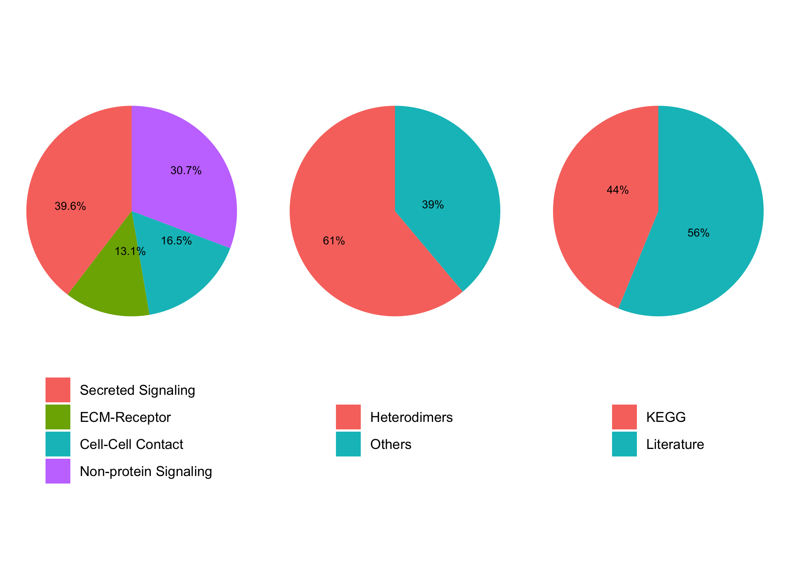<!-- -->

***Output Interpration***

sThe `interaction` table provides a list of known molecular interaction and associated signaling pathways.

The `interaction` dataframe provides a description of cofactors, gene information, receptor information.

The `showDatabaseCategory()` function provides an overview of the interaction categories represented in the database.

NB : Interaction absent from the database can not be inferred through this workflow !

### (B) Selecting the appropriate database for analysis


``` r
cellchat.NL@DB <- CellChatDB.human #assign human database to CellChat object using @DB
```

We use the whole human interaction database to investigate a broad range of signaling mechanisms/pathways. Analysis can be restricted to selected categories of interactions such as Cell-Cell contact for example, depend on the biological question investigated using `CellChatDB.use <- subsetDB(CellChatDB, search = "Cell-Cell Contact")`.

**End of Step 3**

At this stage we have :

-   Explored the CellChat human ligand-receptor database,

-   Selected the appropriate database.

We can now move on with Step 4.

## Step 4 : Identifying overexpressed signaling genes and interactions

### (A) Selecting signaling genes from expression matrix

Before going on with inferration of cell-cell communication, we have to identify which genes in our selected dataset are involved in intercellular signaling.

The expression matrix contains several thousands of gene, not all of them encode ligands, receptors or other molecules involved in cell-cell communication.

The `subsetData()` function selects genes associated with signaling interactions documented in our previously selected CellChatDB database. This reduces the number of genes considered in further analysis, reduce computational cost while focusing the workflow only on relevant signaling molecules.

NB : This step does not yet infer interactions but only extracts relevant data.


``` r
# use a subset of CellChatDB for cell-cell communication analysis
cellchat.NL <- subsetData(cellchat.NL) #necessary step even if using the whole database
dim(cellchat.NL@data.signaling) #dimension of signaling exp matrix
```

```
## [1] 1093 2552
```

``` r
dim(cellchat.NL@data) #compare with original exp matrix
```

```
## [1] 17328  2552
```

***Output interpratation***

The `cellchat.NL@data` contains 17 328 genes.

The `cellchat.NL@data.signaling` contains 1 093 genes that are identified as relevant for intercellular signaling by the CellChat human database. The number of cells must remain similar : 2 552 NL cells.

Here, reduction of analyzed genes have been performed without modifying cellular population.

### (B) Identifying overexpressed signaling genes

Now, we identify signaling genes that are overexpressed in particular cell populations.

The `identifyOverExpressedGenes()` function compares gene expression across annotated cell groups in order to identify signaling genes that are significally enriched in one or more population. It is useful here as CellChat aims to detect communication patterns within specific cell populations.


``` r
#future::plan("multisession", workers = 4) optional - use this to do parallel computing if needed for big dataset
cellchat.NL <- identifyOverExpressedGenes(cellchat.NL)
```

CellChat uses statistical comparisons between cell groups to select preferentially expressed genes.

### (C) Identifying oversexpressed ligand-receptor interaction

Once overexpressed signaling genes have been identified, we can use them to select candidate ligand-receptor interactions.

The `identifyOverExpressedInteractions()` function identifies interactions from CellChatDB supported by overexpressed signaling genes detected.

This step reduces the set of interactions to those who are the most relevant to the observed gene expression patterns.

The `cellchat.NL@LR$LRsig` table contains candidate ligand-receptor interactions selected for subsequent analysis with many informations such as ligand and receptor identities, associated signaling pathways, regulatory cofactors and even biological evidence refering to literature.

NB : This table does not indicate which populations are communicating with each other, it only presents molecular interactions retained prior to network calculation.


``` r
cellchat.NL <- identifyOverExpressedInteractions(cellchat.NL)
```

```
## The number of highly variable ligand-receptor pairs used for signaling inference is 1351
```

``` r
nrow(cellchat.NL@LR$LRsig)
```

```
## [1] 1351
```

``` r
head(cellchat.NL@LR$LRsig)
```

```
##                        interaction_name pathway_name ligand      receptor
## TGFB1_TGFBR1_TGFBR2 TGFB1_TGFBR1_TGFBR2         TGFb  TGFB1     TGFbR1_R2
## TGFB2_TGFBR1_TGFBR2 TGFB2_TGFBR1_TGFBR2         TGFb  TGFB2     TGFbR1_R2
## TGFB3_TGFBR1_TGFBR2 TGFB3_TGFBR1_TGFBR2         TGFb  TGFB3     TGFbR1_R2
## TGFB1_ACVR1B_TGFBR2 TGFB1_ACVR1B_TGFBR2         TGFb  TGFB1 ACVR1B_TGFbR2
## TGFB1_ACVR1C_TGFBR2 TGFB1_ACVR1C_TGFBR2         TGFb  TGFB1 ACVR1C_TGFbR2
## TGFB2_ACVR1B_TGFBR2 TGFB2_ACVR1B_TGFBR2         TGFb  TGFB2 ACVR1B_TGFbR2
##                          agonist      antagonist co_A_receptor
## TGFB1_TGFBR1_TGFBR2 TGFb agonist TGFb antagonist              
## TGFB2_TGFBR1_TGFBR2 TGFb agonist TGFb antagonist              
## TGFB3_TGFBR1_TGFBR2 TGFb agonist TGFb antagonist              
## TGFB1_ACVR1B_TGFBR2 TGFb agonist TGFb antagonist              
## TGFB1_ACVR1C_TGFBR2 TGFb agonist TGFb antagonist              
## TGFB2_ACVR1B_TGFBR2 TGFb agonist TGFb antagonist              
##                                co_I_receptor         annotation
## TGFB1_TGFBR1_TGFBR2 TGFb inhibition receptor Secreted Signaling
## TGFB2_TGFBR1_TGFBR2 TGFb inhibition receptor Secreted Signaling
## TGFB3_TGFBR1_TGFBR2 TGFb inhibition receptor Secreted Signaling
## TGFB1_ACVR1B_TGFBR2 TGFb inhibition receptor Secreted Signaling
## TGFB1_ACVR1C_TGFBR2 TGFb inhibition receptor Secreted Signaling
## TGFB2_ACVR1B_TGFBR2 TGFb inhibition receptor Secreted Signaling
##                          interaction_name_2       evidence is_neurotransmitter
## TGFB1_TGFBR1_TGFBR2 TGFB1 - (TGFBR1+TGFBR2) KEGG: hsa04350               FALSE
## TGFB2_TGFBR1_TGFBR2 TGFB2 - (TGFBR1+TGFBR2) KEGG: hsa04350               FALSE
## TGFB3_TGFBR1_TGFBR2 TGFB3 - (TGFBR1+TGFBR2) KEGG: hsa04350               FALSE
## TGFB1_ACVR1B_TGFBR2 TGFB1 - (ACVR1B+TGFBR2) PMID: 27449815               FALSE
## TGFB1_ACVR1C_TGFBR2 TGFB1 - (ACVR1C+TGFBR2) PMID: 27449815               FALSE
## TGFB2_ACVR1B_TGFBR2 TGFB2 - (ACVR1B+TGFBR2) PMID: 27449815               FALSE
##                     ligand.symbol ligand.family
## TGFB1_TGFBR1_TGFBR2         TGFB1      TGF-beta
## TGFB2_TGFBR1_TGFBR2         TGFB2      TGF-beta
## TGFB3_TGFBR1_TGFBR2         TGFB3      TGF-beta
## TGFB1_ACVR1B_TGFBR2         TGFB1      TGF-beta
## TGFB1_ACVR1C_TGFBR2         TGFB1      TGF-beta
## TGFB2_ACVR1B_TGFBR2         TGFB2      TGF-beta
##                                                         ligand.location
## TGFB1_TGFBR1_TGFBR2 Extracellular matrix, Secreted, Extracellular space
## TGFB2_TGFBR1_TGFBR2 Extracellular matrix, Secreted, Extracellular space
## TGFB3_TGFBR1_TGFBR2 Extracellular matrix, Secreted, Extracellular space
## TGFB1_ACVR1B_TGFBR2 Extracellular matrix, Secreted, Extracellular space
## TGFB1_ACVR1C_TGFBR2 Extracellular matrix, Secreted, Extracellular space
## TGFB2_ACVR1B_TGFBR2 Extracellular matrix, Secreted, Extracellular space
##                                                                                                                                                                                                                                                                                       ligand.keyword
## TGFB1_TGFBR1_TGFBR2                                                                   Disease variant, Signal, Reference proteome, Extracellular matrix, Disulfide bond, Secreted, Mitogen, Growth factor, Direct protein sequencing, Cleavage on pair of basic residues, 3D-structure, Glycoprotein
## TGFB2_TGFBR1_TGFBR2 Disease variant, Chromosomal rearrangement, Signal, Reference proteome, Disulfide bond, Secreted, Extracellular matrix, Mitogen, Growth factor, Direct protein sequencing, 3D-structure, Cleavage on pair of basic residues, Alternative splicing, Aortic aneurysm, Glycoprotein
## TGFB3_TGFBR1_TGFBR2                                           Disease variant, Signal, Reference proteome, Extracellular matrix, Disulfide bond, Secreted, Mitogen, Cardiomyopathy, Growth factor, Cleavage on pair of basic residues, Alternative splicing, 3D-structure, Methylation, Glycoprotein
## TGFB1_ACVR1B_TGFBR2                                                                   Disease variant, Signal, Reference proteome, Extracellular matrix, Disulfide bond, Secreted, Mitogen, Growth factor, Direct protein sequencing, Cleavage on pair of basic residues, 3D-structure, Glycoprotein
## TGFB1_ACVR1C_TGFBR2                                                                   Disease variant, Signal, Reference proteome, Extracellular matrix, Disulfide bond, Secreted, Mitogen, Growth factor, Direct protein sequencing, Cleavage on pair of basic residues, 3D-structure, Glycoprotein
## TGFB2_ACVR1B_TGFBR2 Disease variant, Chromosomal rearrangement, Signal, Reference proteome, Disulfide bond, Secreted, Extracellular matrix, Mitogen, Growth factor, Direct protein sequencing, 3D-structure, Cleavage on pair of basic residues, Alternative splicing, Aortic aneurysm, Glycoprotein
##                       ligand.secreted_type ligand.transmembrane receptor.symbol
## TGFB1_TGFBR1_TGFBR2          growth factor                FALSE  TGFBR2, TGFBR1
## TGFB2_TGFBR1_TGFBR2          growth factor                FALSE  TGFBR2, TGFBR1
## TGFB3_TGFBR1_TGFBR2 cytokine;growth factor                 TRUE  TGFBR2, TGFBR1
## TGFB1_ACVR1B_TGFBR2          growth factor                FALSE  TGFBR2, ACVR1B
## TGFB1_ACVR1C_TGFBR2          growth factor                FALSE  TGFBR2, ACVR1C
## TGFB2_ACVR1B_TGFBR2          growth factor                FALSE  TGFBR2, ACVR1B
##                                                            receptor.family
## TGFB1_TGFBR1_TGFBR2 Protein kinase superfamily, TKL Ser/Thr protein kinase
## TGFB2_TGFBR1_TGFBR2 Protein kinase superfamily, TKL Ser/Thr protein kinase
## TGFB3_TGFBR1_TGFBR2 Protein kinase superfamily, TKL Ser/Thr protein kinase
## TGFB1_ACVR1B_TGFBR2 Protein kinase superfamily, TKL Ser/Thr protein kinase
## TGFB1_ACVR1C_TGFBR2 Protein kinase superfamily, TKL Ser/Thr protein kinase
## TGFB2_ACVR1B_TGFBR2 Protein kinase superfamily, TKL Ser/Thr protein kinase
##                                                                                       receptor.location
## TGFB1_TGFBR1_TGFBR2 Cell membrane, Secreted, Membrane raft, Cell surface, Cell junction, Tight junction
## TGFB2_TGFBR1_TGFBR2 Cell membrane, Secreted, Membrane raft, Cell surface, Cell junction, Tight junction
## TGFB3_TGFBR1_TGFBR2 Cell membrane, Secreted, Membrane raft, Cell surface, Cell junction, Tight junction
## TGFB1_ACVR1B_TGFBR2                                              Cell membrane, Secreted, Membrane raft
## TGFB1_ACVR1C_TGFBR2                                    Cell membrane, Secreted, Membrane raft, Membrane
## TGFB2_ACVR1B_TGFBR2                                              Cell membrane, Secreted, Membrane raft
##                                                                                                                                                                                                                                                                                                                                                                                                                                                                                                                                                                        receptor.keyword
## TGFB1_TGFBR1_TGFBR2 Membrane, Secreted, Disulfide bond, Kinase, Transmembrane, Differentiation, ATP-binding, Receptor, Alternative splicing, Aortic aneurysm, Transferase, Glycoprotein, Manganese, Disease variant, Growth regulation, Signal, Reference proteome, Metal-binding, Transmembrane helix, Hereditary nonpolyposis colorectal cancer, Cell membrane, Phosphoprotein, Direct protein sequencing, Apoptosis, Craniosynostosis, Serine/threonine-protein kinase, 3D-structure, Nucleotide-binding, Magnesium, Tight junction, Isopeptide bond, Cell junction, Ubl conjugation
## TGFB2_TGFBR1_TGFBR2 Membrane, Secreted, Disulfide bond, Kinase, Transmembrane, Differentiation, ATP-binding, Receptor, Alternative splicing, Aortic aneurysm, Transferase, Glycoprotein, Manganese, Disease variant, Growth regulation, Signal, Reference proteome, Metal-binding, Transmembrane helix, Hereditary nonpolyposis colorectal cancer, Cell membrane, Phosphoprotein, Direct protein sequencing, Apoptosis, Craniosynostosis, Serine/threonine-protein kinase, 3D-structure, Nucleotide-binding, Magnesium, Tight junction, Isopeptide bond, Cell junction, Ubl conjugation
## TGFB3_TGFBR1_TGFBR2 Membrane, Secreted, Disulfide bond, Kinase, Transmembrane, Differentiation, ATP-binding, Receptor, Alternative splicing, Aortic aneurysm, Transferase, Glycoprotein, Manganese, Disease variant, Growth regulation, Signal, Reference proteome, Metal-binding, Transmembrane helix, Hereditary nonpolyposis colorectal cancer, Cell membrane, Phosphoprotein, Direct protein sequencing, Apoptosis, Craniosynostosis, Serine/threonine-protein kinase, 3D-structure, Nucleotide-binding, Magnesium, Tight junction, Isopeptide bond, Cell junction, Ubl conjugation
## TGFB1_ACVR1B_TGFBR2                                                 Membrane, Secreted, Disulfide bond, Kinase, Transmembrane, Differentiation, ATP-binding, Receptor, Alternative splicing, Aortic aneurysm, Transferase, Glycoprotein, Manganese, Disease variant, Growth regulation, Signal, Reference proteome, Metal-binding, Transmembrane helix, Hereditary nonpolyposis colorectal cancer, Cell membrane, Phosphoprotein, Direct protein sequencing, Apoptosis, Craniosynostosis, Serine/threonine-protein kinase, 3D-structure, Nucleotide-binding, Magnesium, Ubl conjugation
## TGFB1_ACVR1C_TGFBR2                                                                  Membrane, Secreted, Disulfide bond, Kinase, Transmembrane, Differentiation, ATP-binding, Receptor, Alternative splicing, Aortic aneurysm, Transferase, Glycoprotein, Manganese, Disease variant, Growth regulation, Signal, Reference proteome, Metal-binding, Transmembrane helix, Hereditary nonpolyposis colorectal cancer, Cell membrane, Phosphoprotein, Direct protein sequencing, Apoptosis, Craniosynostosis, Serine/threonine-protein kinase, 3D-structure, Nucleotide-binding, Magnesium
## TGFB2_ACVR1B_TGFBR2                                                 Membrane, Secreted, Disulfide bond, Kinase, Transmembrane, Differentiation, ATP-binding, Receptor, Alternative splicing, Aortic aneurysm, Transferase, Glycoprotein, Manganese, Disease variant, Growth regulation, Signal, Reference proteome, Metal-binding, Transmembrane helix, Hereditary nonpolyposis colorectal cancer, Cell membrane, Phosphoprotein, Direct protein sequencing, Apoptosis, Craniosynostosis, Serine/threonine-protein kinase, 3D-structure, Nucleotide-binding, Magnesium, Ubl conjugation
##                     receptor.surfaceome_main receptor.surfaceome_sub
## TGFB1_TGFBR1_TGFBR2                Receptors         Act.TGFB;Kinase
## TGFB2_TGFBR1_TGFBR2                Receptors         Act.TGFB;Kinase
## TGFB3_TGFBR1_TGFBR2                Receptors         Act.TGFB;Kinase
## TGFB1_ACVR1B_TGFBR2                Receptors         Act.TGFB;Kinase
## TGFB1_ACVR1C_TGFBR2                Receptors         Act.TGFB;Kinase
## TGFB2_ACVR1B_TGFBR2                Receptors         Act.TGFB;Kinase
##                     receptor.adhesome receptor.secreted_type
## TGFB1_TGFBR1_TGFBR2                                         
## TGFB2_TGFBR1_TGFBR2                                         
## TGFB3_TGFBR1_TGFBR2                                         
## TGFB1_ACVR1B_TGFBR2                                         
## TGFB1_ACVR1C_TGFBR2                                         
## TGFB2_ACVR1B_TGFBR2                                         
##                     receptor.transmembrane       version
## TGFB1_TGFBR1_TGFBR2                   TRUE CellChatDB v1
## TGFB2_TGFBR1_TGFBR2                   TRUE CellChatDB v1
## TGFB3_TGFBR1_TGFBR2                   TRUE CellChatDB v1
## TGFB1_ACVR1B_TGFBR2                   TRUE CellChatDB v1
## TGFB1_ACVR1C_TGFBR2                   TRUE CellChatDB v1
## TGFB2_ACVR1B_TGFBR2                   TRUE CellChatDB v1
```

``` r
#verify that analysis include NL cells only
ncol(cellchat.NL@data) #expected number = 2552
```

```
## [1] 2552
```

``` r
stopifnot(ncol(cellchat.NL@data) == 2552)
```

***Output interpratation***

CellChat identified 1 351 candidates ligand-receptor interactions for downstream communication inference.

The first entries of `cellchat.NL@LR$LRsig` table correspond to TGFB signaling pathway and involve TGFB-1, 2 and 3 ligands and other multimeric receptor complexes.

This is illustrating 2 important features of CellChat :

-   A single signaling pathway can involve several ligand-receptor interactions,

-   Some receptors consists of multiple protein subunits.

**End of Step 4**

We narrowed down our analysis from the whole transcriptomic dataset to only a set of signaling-related genes and candidate ligand-receptor interactions.

The potential involvement of these candidates in intercellular signaling will be assessed in the next step.

## Step 5 : Computing cell-cell communication probabilities

Our main objective is now to investigate which cell populations may communicate, how strong their potential communication is and if the interaction is statistically relevant.

To do this, CellChat uses a probabilistic model based on law of mass action (by using Hill function and several corrections linked to cell group size, cofactors and other).

To simplify, the underlying assumption is that communication between a sender population (the one expressing a ligand) and a receiver population (expressing receptor) depends on the expression levels of both partners.

For each candidate L-R interaction, CellChat estimates a communication score between pairs of cell populations using their aggregated gene expression profiles, while accouting for molecular complexity (multimeric receptor complexes, regulatory cofactors).

Then, it evaluates the statistical relevance for inferred interaction though a permutation-based procedure in which each cell group labels are shuffled randomly.

### (A) Selecting inference parameters

Before going on with computation of communication propabilities, several parameters must be considered. These parameters influence how CellChat will estimate potential signaling strength and evaluates statistical support.

For this tutorial, we retain the following settings :

-   `type = "triMean"` : estimates gene expression at the cell-population level using the trimean. This is the default option and produces fewer but stronger inferred interactions.

-   `population.size = FALSE` : does not weight communication strength by relative abundance of each cell population. The primary focus will be on ligand-receptor expression rather than population size. In our dataset, this choice is interesting because the NL populations are highly imbalanced.

-   `nboot = 100` : performs 100 random permutations of cell-group labels to assess statistical support for the inferred interactions.

-   `seed.use = 28` : set a random seed for reproducibility purposes.

The same settings will be apply for the lesional dataset in Part 2 of tutorial.

NB : An alternative choice to `type = "triMean"` is the truncated mean `type = "trucatedMean"` that can detect more interaction depending on the selected trimming population. The choice between those two methods illustrate the trade-off between more conservation and more permissive communication inference.

### (B) Computing communication probalities

We use now the function `computeCommunProb()` to estimate the strength of potential communication between the annotated cell populations.

For each candidate L-R interaction, CellChat evaluates possible sender-receiver pairs using the expression of signaling molecules.

Statistical support is assessed though random permutations of cell-group labels.

NB : Please note that computation time may take several minutes depending on dataset size and number of permutation. For the dataset used in this tutorial it takes about 1/2 minutes as the dataset size is small.


``` r
stopifnot(ncol(cellchat.NL@data) == 2552) #check if all NL cells are included
cellchat.NL <- computeCommunProb(cellchat.NL, type = "triMean", population.size = FALSE, nboot = 100, seed.use = 28)
```

```
## triMean is used for calculating the average gene expression per cell group. 
## [1] ">>> Run CellChat on sc/snRNA-seq data <<< [2026-10-16 03:24:30.923737]"
## [1] ">>> CellChat inference is done. Parameter values are stored in `object@options$parameter` <<< [2026-10-16 03:25:06.90721]"
```

After execution, CellChat stores two objects within `cellchat.NL@net` : `@net$prob` containing inferred communication scores and `@net$pval` containing p-values calculated using n permutations.


``` r
#Check dimension of 3D array : we expect 12 (sender population) x 12 (receiver population) x 1351 (candidates interaction)
dim(cellchat.NL@net$prob)
```

```
## [1]   12   12 1351
```

``` r
dim(cellchat.NL@net$pval)
```

```
## [1]   12   12 1351
```

``` r
#Check the parameters stored by CellChat for computation
cellchat.NL@options$parameter
```

```
## $type.mean
## [1] "triMean"
## 
## $trim
## [1] 0.1
## 
## $raw.use
## [1] TRUE
## 
## $population.size
## [1] FALSE
## 
## $nboot
## [1] 100
## 
## $seed.use
## [1] 28
## 
## $Kh
## [1] 0.5
## 
## $n
## [1] 1
## 
## $distance.use
## NULL
## 
## $interaction.range
## NULL
## 
## $ratio
## NULL
## 
## $tol
## NULL
## 
## $k.min
## NULL
## 
## $contact.dependent
## [1] FALSE
## 
## $contact.range
## NULL
## 
## $contact.knn.k
## NULL
## 
## $contact.dependent.forced
## [1] FALSE
```

### (C) Filtering and inspecting inferred communications

Some cell populations in our dataset contains very few cells. For exemple the cDC1 population (7 cells) and the inflammatory dendritic cell population (1 cell). Such small groups may provide unreliable estimates of average gene expression and therefore affect inferred communication scores.

To adress this, we use the `filterCommunication()` function to exclude inferred communication with cell populations that have a few number of cells.

We select `min.cells = 10` which is the default value.

NB : `filterCommunication()` preserves the structure of the array and sets the probabilities for the excluded populations to zero, rather than physically removing them from our dataset.


``` r
table(cellchat.NL@idents) #display cell counts
```

```
## 
##    APOE+ FIB    FBN1+ FIB COL11A1+ FIB  Inflam. FIB         cDC1         cDC2 
##         1215          548          196           69            7           38 
##           LC   Inflam. DC           TC   Inflam. TC   CD40LG+ TC          NKT 
##           20            1          212           44          166           36
```

``` r
cellchat.NL <- filterCommunication(cellchat.NL, min.cells = 10) #apply the filter
```

```
## The cell-cell communication related with the following cell groups are excluded due to the few number of cells:  cDC1, Inflam. DC ! 	39.6% interactions are removed!
```

``` r
dim(cellchat.NL@net$prob) #check filter communication probability array
```

```
## [1]   12   12 1351
```

CellChat indicates that 39.6% of interactions are removed when filtering out cDC1 and Inflam.DC.

After filtering, we can extract the inferred communications using the `subsetCommunication()` function that converts the results into a table that shows sender/receiver populations, L-R interactions, communication scores and statistical significance. Allowing us to do an exploratory analysis and biological interpretation.

`thresh = 0.05` is the default value for significance threshold.


``` r
#extract inferred communications
df.net.NL <- subsetCommunication(cellchat.NL, thresh = 0.05)
nrow(df.net.NL)
```

```
## [1] 605
```

``` r
head(df.net.NL)
```

```
##        source       target ligand receptor        prob pval interaction_name
## 1   APOE+ FIB    APOE+ FIB   FGF7    FGFR1 0.007916143 0.00       FGF7_FGFR1
## 2 Inflam. FIB    APOE+ FIB   FGF7    FGFR1 0.007424840 0.00       FGF7_FGFR1
## 3   APOE+ FIB    FBN1+ FIB   FGF7    FGFR1 0.009222256 0.00       FGF7_FGFR1
## 4 Inflam. FIB    FBN1+ FIB   FGF7    FGFR1 0.008650598 0.00       FGF7_FGFR1
## 5   APOE+ FIB COL11A1+ FIB   FGF7    FGFR1 0.008360141 0.00       FGF7_FGFR1
## 6 Inflam. FIB COL11A1+ FIB   FGF7    FGFR1 0.007841500 0.02       FGF7_FGFR1
##   interaction_name_2 pathway_name         annotation     evidence
## 1       FGF7 - FGFR1          FGF Secreted Signaling PMC: 4393358
## 2       FGF7 - FGFR1          FGF Secreted Signaling PMC: 4393358
## 3       FGF7 - FGFR1          FGF Secreted Signaling PMC: 4393358
## 4       FGF7 - FGFR1          FGF Secreted Signaling PMC: 4393358
## 5       FGF7 - FGFR1          FGF Secreted Signaling PMC: 4393358
## 6       FGF7 - FGFR1          FGF Secreted Signaling PMC: 4393358
```

***Output interpretation***

We obtain 605 inferred communication records. Each record corresponds to a unique combinaison of a sender population, a receiver population and a L-R interaction.

For example, the FGF7-FGFR1 interaction, which is associated with the FGF signaling pathway, is inferred between fibroblast populations. Some interactions are predicted within the same cell population (APOE+ fibroblasts) suggesting autocrine signaling.

These results indicate that fibroblast subpopulations may participate in FGF-mediated communication in nonlesional skin. However, as these interactions are inferred from transcriptomic data, actual signaling activity must be confirmed though experimental validation.

### (D) Compare gene expression estimators (OPTIONAL)

The results obtained from a CellChat analysis depend on methodological choices, even if we use the same data.

To illustrate this, we choose to use the `truncatedMean` option with `trim = 0.1` as it is documented in the official CellChat vignette.


``` r
#Creation of a separate copy for alternative analysis
cellchat.NL.truncated <- cellchat.NL 

cellchat.NL.truncated <- computeCommunProb(cellchat.NL.truncated, type = "truncatedMean", trim = 0.1, population.size = FALSE, nboot = 100, seed.use = 28)
```

```
## truncatedMean is used for calculating the average gene expression per cell group. 
## [1] ">>> Run CellChat on sc/snRNA-seq data <<< [2026-10-16 03:25:07.519234]"
## [1] ">>> CellChat inference is done. Parameter values are stored in `object@options$parameter` <<< [2026-10-16 03:26:05.459666]"
```

``` r
cellchat.NL.truncated <- filterCommunication(cellchat.NL.truncated, min.cells = 10)
```

```
## The cell-cell communication related with the following cell groups are excluded due to the few number of cells:  cDC1, Inflam. DC ! 	31.5% interactions are removed!
```

``` r
df.net.NL.truncated <- subsetCommunication(cellchat.NL.truncated, thresh = 0.05)
nrow(df.net.NL.truncated)
```

```
## [1] 2017
```

``` r
head(df.net.NL.truncated)
```

```
##       source    target ligand  receptor         prob pval    interaction_name
## 1       cDC2       NKT  TGFB1 TGFbR1_R2 0.0028799249    0 TGFB1_TGFBR1_TGFBR2
## 2         LC       NKT  TGFB1 TGFbR1_R2 0.0013267924    0 TGFB1_TGFBR1_TGFBR2
## 3 Inflam. TC       NKT  TGFB1 TGFbR1_R2 0.0008104401    0 TGFB1_TGFBR1_TGFBR2
## 4 CD40LG+ TC       NKT  TGFB1 TGFbR1_R2 0.0008906976    0 TGFB1_TGFBR1_TGFBR2
## 5        NKT       NKT  TGFB1 TGFbR1_R2 0.0010600315    0 TGFB1_TGFBR1_TGFBR2
## 6       cDC2 FBN1+ FIB   AREG      EGFR 0.0002383963    0           AREG_EGFR
##        interaction_name_2 pathway_name         annotation       evidence
## 1 TGFB1 - (TGFBR1+TGFBR2)         TGFb Secreted Signaling KEGG: hsa04350
## 2 TGFB1 - (TGFBR1+TGFBR2)         TGFb Secreted Signaling KEGG: hsa04350
## 3 TGFB1 - (TGFBR1+TGFBR2)         TGFb Secreted Signaling KEGG: hsa04350
## 4 TGFB1 - (TGFBR1+TGFBR2)         TGFb Secreted Signaling KEGG: hsa04350
## 5 TGFB1 - (TGFBR1+TGFBR2)         TGFb Secreted Signaling KEGG: hsa04350
## 6             AREG - EGFR          EGF Secreted Signaling KEGG: hsa04012
```

``` r
cat("triMean", nrow(df.net.NL), "communications")
```

```
## triMean 605 communications
```

``` r
cat("truncatedMean", nrow(df.net.NL.truncated), "communications")
```

```
## truncatedMean 2017 communications
```

***Output interpretation***

The choice of expression estimator heavily influences CellChat results.

Using `truncatedMean, trim = 0.1` we obtained 2 017 inferred communication, corresponding to approximately 3 times more interactions than using `triMean`.

This illustrates that `truncatedMean` is less conservative and can detect additional potential signaling interactions that are not retained with `triMean`.

However, this does not mean that using `truncatedMean` provides more biologically accurate results.

**End of Step 5**

We inferred potential cell-cell communication from the candidates L-R interactions extracted in the previous step.

We applied a minimum cell population size threshold to reduce the influence of extremely small cell groups.

Results (communication probability and p-values) was explored using `subsetCommunication()`.

NB : Statistical significance does not equal to biological relevance as communication score are model-based estimates, so our selected parameters heavily influence the inferred interactions here. Plus, the inferred communication network is condition-specific.

## Step 6 - Inferring signaling pathways and aggregating communication networks

In the previous step, we inferred potential cell-cell communications at individual L-R level. But, multiple L-R interaction can belong to the same signaling pathway. CellChat can summarize communication probabilities at the signaling pathway level.

### (A) Inferring communication at signaling pathway level

The `computeCommunProbPathway()` function aggregates the communication probabilities of statistically supported L-R interactions associated with each signaling pathway.

This allows us to investigate which signaling pathways potentially mediate communication between specific cell populations, rather than focusing only on individual molecular interactions.


``` r
cellchat.NL <- computeCommunProbPathway(cellchat.NL)

cellchat.NL@netP$pathways #inferred signaling pathways
```

```
##  [1] "COLLAGEN"      "MIF"           "CD45"          "LAMININ"      
##  [5] "FN1"           "APP"           "CypA"          "ANNEXIN"      
##  [9] "CXCL"          "Prostaglandin" "GALECTIN"      "CLDN"         
## [13] "THBS"          "THY1"          "COMPLEMENT"    "CLEC"         
## [17] "MHC-II"        "PTN"           "CD40"          "Cholesterol"  
## [21] "FGF"           "PDGF"          "ICAM"          "PLAU"         
## [25] "GAS"           "VCAM"          "ADGRE"         "CD80"         
## [29] "GAP"           "VEGF"          "LIGHT"         "JAM"          
## [33] "CSF"           "CysLTs"
```

``` r
length(cellchat.NL@netP$pathways) #count them
```

```
## [1] 34
```

``` r
dim(cellchat.NL@netP$prob) #pathway communication array
```

```
## [1] 12 12 34
```

`cellchat.NL@net$pathways` contains the names of the signaling pathways identified by CellChat.

`cellchat.NL@net$prob` is a 3D array containing : sender population, receiver population and signaling pathway.

***Output interpretation***

CellChat identified 34 signaling pathways potentially involved in cell-cell communication such as COLLAGEN, LAMININ, VEGF, FGF or CXCL. Those pathways are involved in growth factor signaling, immune communication and extracellular matrix interactions.

The pathway communication array has dimensions of 12 x 12 x 34, so 12 sender populations, 12 receiver populations and 34 inferred signaling pathways.

These results illustrates how CellChat summarizes individual L-R interatcions into signaling pathways. Further analysis is needed to compare pathway communication strength.

### (B) Aggreating the cell-cell communication network

Now, we will use CellChat to construct a global communication network summarizing the interactions between cell populations.

The `aggregateNet()` function generates 2 complementary representations :

-   Interaction count (`net$count`) : the number of statistically supported L-R interactions inferred between sender-receiver pair,

-   Interaction weight (`net$weight`) : the total inferred communication strength between each population pair obtained by aggregation of individual communication scores.

A cell population may participate in many predicted interactions without having the highest total communication strength (and vice-versa).

Those mesures will be useful for interpreting and visualizing global communication network in Step 7.


``` r
cellchat.NL <- aggregateNet(cellchat.NL)

dim(cellchat.NL@net$count)
```

```
## [1] 12 12
```

``` r
dim(cellchat.NL@net$weight)
```

```
## [1] 12 12
```

``` r
cellchat.NL@net$count
```

```
##              APOE+ FIB FBN1+ FIB COL11A1+ FIB Inflam. FIB cDC1 cDC2 LC
## APOE+ FIB            2        11            2           7    0   10 15
## FBN1+ FIB            7        16            4           9    0   17 25
## COL11A1+ FIB         6        16            4           9    0   16 21
## Inflam. FIB         10        19            4          10    0   17 24
## cDC1                 0         0            0           0    0    0  0
## cDC2                 0         3            1           2    0    7 23
## LC                   3         7            2           5    0   15 36
## Inflam. DC           0         0            0           0    0    0  0
## TC                   0         1            0           0    0    3  4
## Inflam. TC           0         2            1           0    0    4  8
## CD40LG+ TC           0         2            1           1    0    6  7
## NKT                  0         2            1           1    0    4  6
##              Inflam. DC TC Inflam. TC CD40LG+ TC NKT
## APOE+ FIB             0  6          2          7   2
## FBN1+ FIB             0  8         10         10   6
## COL11A1+ FIB          0  8         10          9   7
## Inflam. FIB           0  9         12         11   7
## cDC1                  0  0          0          0   0
## cDC2                  0  0          4          2   1
## LC                    0  2          7          4   5
## Inflam. DC            0  0          0          0   0
## TC                    0  0          1          0   3
## Inflam. TC            0  0          2          1   2
## CD40LG+ TC            0  0          1          0   3
## NKT                   0  0          1          0   3
```

``` r
cellchat.NL@net$weight
```

```
##               APOE+ FIB   FBN1+ FIB COL11A1+ FIB Inflam. FIB cDC1      cDC2
## APOE+ FIB    0.01640649 0.242430802  0.009859715  0.40388967    0 0.7838693
## FBN1+ FIB    0.26563223 0.553301839  0.014179740  0.67394087    0 1.3079038
## COL11A1+ FIB 0.22956092 0.659442570  0.018243841  0.77311102    0 1.5381954
## Inflam. FIB  0.30785348 0.638629976  0.031898028  0.72889060    0 1.3285801
## cDC1         0.00000000 0.000000000  0.000000000  0.00000000    0 0.0000000
## cDC2         0.00000000 0.062529065  0.031005785  0.03117756    0 0.4182300
## LC           0.02939273 0.098453405  0.032506727  0.05944191    0 0.6315436
## Inflam. DC   0.00000000 0.000000000  0.000000000  0.00000000    0 0.0000000
## TC           0.00000000 0.009569664  0.000000000  0.00000000    0 0.2672634
## Inflam. TC   0.00000000 0.040201359  0.012118272  0.00000000    0 0.3998164
## CD40LG+ TC   0.00000000 0.054373364  0.029469690  0.02487556    0 0.4631253
## NKT          0.00000000 0.046117368  0.028937289  0.02442407    0 0.3385025
##                     LC Inflam. DC        TC  Inflam. TC  CD40LG+ TC        NKT
## APOE+ FIB    1.0904335          0 0.2643661 0.029510512 0.664992652 0.03618794
## FBN1+ FIB    1.5873588          0 0.4454693 0.644737540 1.000252085 0.15552101
## COL11A1+ FIB 1.8607694          0 0.5149804 0.671063811 1.127228697 0.27576735
## Inflam. FIB  1.7317538          0 0.4841216 0.734920087 1.126187041 0.17100902
## cDC1         0.0000000          0 0.0000000 0.000000000 0.000000000 0.00000000
## cDC2         0.8169183          0 0.0000000 0.068947738 0.021128377 0.08634714
## LC           1.1681238          0 0.0471513 0.137550597 0.069214909 0.17549392
## Inflam. DC   0.0000000          0 0.0000000 0.000000000 0.000000000 0.00000000
## TC           0.3354177          0 0.0000000 0.009326516 0.000000000 0.05884630
## Inflam. TC   0.6527934          0 0.0000000 0.035064165 0.006973065 0.10648592
## CD40LG+ TC   0.6986863          0 0.0000000 0.025828819 0.000000000 0.14667290
## NKT          0.5021706          0 0.0000000 0.018267398 0.000000000 0.08335333
```

***Output interpratation***

`aggregateNet()` function generated two 12x12 matrices summarizing inferred communication network between the 12 cell populations.

`net$count` matrix represents the number of inferred L-R interactions between each sender and receiver pair.

`net$weight` matrix represents their aggregated communication strength.

For example, Langerhans cells (LC) receive 24 interactions from inflammatory fibroblasts with a total communication weight of 1.73. In comparaison, FBN1+ fibroblasts send 25 interactions to LC, with an aggregated weight of approximatively 1.59.

These results illustrate that the number of inferred interactions and their total communication strength provide complementary information and do not necessarily follow the same ranking.

### (C) Exploring aggregated results

We can now explore global communication patterns across cell populations.

For each population, we calculate :

-   Outgoing interactions : the total inferred communication originating from that cell population,

-   Incoming interactions : the total number of inferred interactions received by that cell population.

This provides an initial overview of which populations may act as major signaling senders or receivers.


``` r
outgoing.NL <- rowSums(cellchat.NL@net$count)
incoming.NL <- colSums(cellchat.NL@net$count)

#Create table
network.table.NL <- data.frame(cell_population = names(outgoing.NL), outgoing = as.numeric(outgoing.NL), incoming = as.numeric(incoming.NL))
network.table.NL <- network.table.NL[order(-network.table.NL$outgoing) , ] #sort by outgoing interaction count
network.table.NL
```

```
##    cell_population outgoing incoming
## 4      Inflam. FIB      123       44
## 2        FBN1+ FIB      112       79
## 3     COL11A1+ FIB      106       20
## 7               LC       86      169
## 1        APOE+ FIB       64       28
## 6             cDC2       43       99
## 11      CD40LG+ TC       21       44
## 10      Inflam. TC       20       50
## 12             NKT       18       39
## 9               TC       12       33
## 5             cDC1        0        0
## 8       Inflam. DC        0        0
```

***Output interpretation***

The table shows diffrences in the number of inferred incoming and outgoing interactions across cell populations.

Inflammatory fibroblasts show the highest number of outgoing interactions (123), followed by FBN1+ fibroblasts and COL11A1+ fibroblasts. This suggests that fibroblast subpopulations may act as major signaling senders in nonlesional skin.

Langerhans cells receive the highest number of incoming interaction, followed by cDC2 and FBN1+ fibroblasts suggesting that these populations may represent important signaling targets.

LC exhibit both high number of outgoing and incoming interactions, suggesting an important role in the overall communication network.

NB : Interaction counts alone do not establish biological importance or signaling activity. More detailed network analysis are needed to characterize functional roles of those cell populations.

**End of Step 6**

Our results highlights a distinction between the three levels of analysis :

-   Pathway level : which signaling pathways are involved ? -\> 34 pathways.

-   Network level : how many interatcions are there, what is the total strength between each pair of cell populations ? -\> two 12x12 matrices.

-   Cell population level : which population appears to be the primary senders and receivers of signals ? -\> Fibroblasts as major senders and LC population as major receiver.

This step provides a more comprehensive overview of potential cell-cell communication in non lesional skin. By examining incoming and outgoing interactions, we can begin to identify which cell populations may play important roles in intercellular signaling.

## Step 7 : Visualizing and interpreting communication networks

### (A) Global circle plots

Circle plots provide an intuitive representation of the inferred communication network between cell populations.

-   Nodes represent an annotated cell population, size represent the number of cell in each population

-   Edges represent potential communication from a sender population to a receiver population, thickness reflects corresponding interaction count or strength

We will visualize two network properties :

-   Number of L-R interactions between cell populations,

-   Interaction strength : aggregated communication scores between cell populations.


``` r
groupSize.NL <- as.numeric(table(cellchat.NL@idents)) #number of cells in each population

par(mfrow = c(1,2), xpd = TRUE) #display the 2 circle plots side by side

#Plot number of inferred interactions
netVisual_circle(cellchat.NL@net$count, vertex.weight = groupSize.NL, weight.scale = TRUE, label.edge = FALSE, title.name = "Number of interactions")

#Plot total inferred communication strength
netVisual_circle(cellchat.NL@net$weight, vertex.weight = groupSize.NL, weight.scale = TRUE, label.edge = FALSE, title.name = "Interaction strength")
```

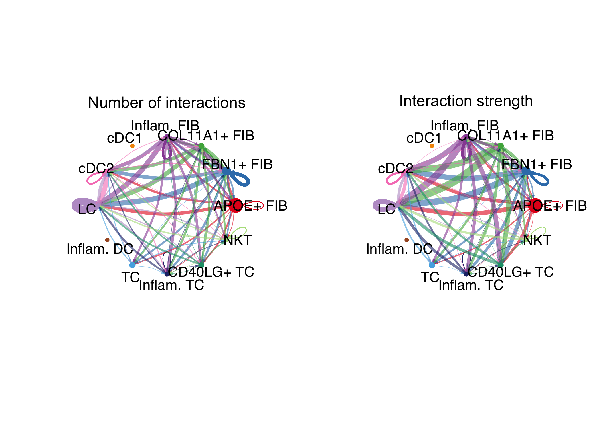<!-- -->

``` r
par(mfrow = c(1,1))
```

***Output interpretation***

The global circle plot reveals an extensive network of inferred cell-cell communication in nonlesional skin. There are prominent connection involving Langerhans cells and fibroblasts populations.

The interaction count network hightlights many predicted connections originating form fibroblasts (inflammatory, FBN1+, COL11A1+), same for interaction strength network.

Both networks suggests an important role of fibroblast populations to outgoing signaling, while LC seems to be a major receiver.

Some populations display self directed interactions, suggesting autocrine signaling.

### (B) Communication heatmaps

Heatmaps provide a complementary representation by displaying cell population as rows (senders) and columns (receivers). Each matrix cell summarizes inferred communication between sender-receiver pair.

We will generate two heatmaps to compare the number of interaction with their aggregated communication strength.

This visualization makes it easier to identify strongly connected cell population pairs and detect differences between interaction count and communication strength.


``` r
netVisual_heatmap(cellchat.NL, measure = "count", color.heatmap = "Blues") #interaction count
```

```
## Do heatmap based on a single object
```

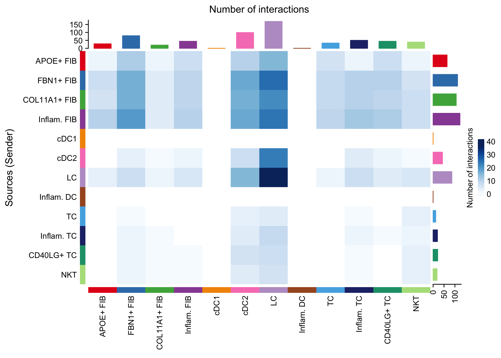<!-- -->

``` r
netVisual_heatmap(cellchat.NL, measure = "weight", color.heatmap = "Reds") #aggregated interaction strengths
```

```
## Do heatmap based on a single object
```

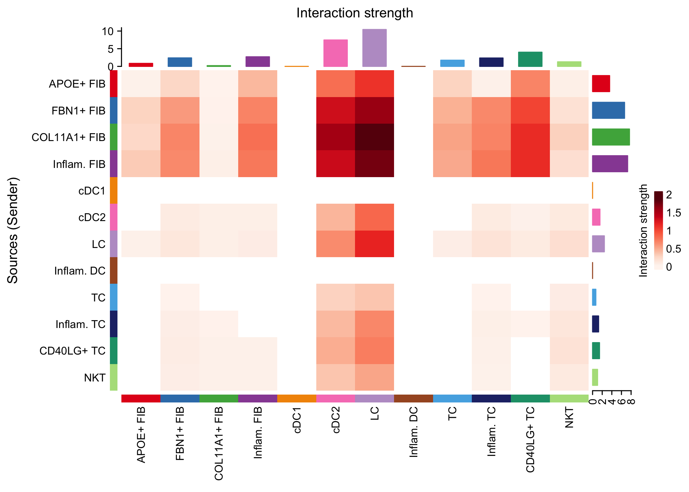<!-- -->

***Output interpretation***

In the interaction count heatmat, fibroblast populations display many outgoing interactions, Langerhans cells show the highest number of incoming interactions.

The interaction strength heatmap reveals particularly strong inferred communication from fibroblast populations toward LC and cDC2.

As an example, COL11A1+ fibroblasts exhibit a high aggregated communication strength toward Langerhans cells (between 1.5 and 2.0). This is consistent with the results obtained in Step 6.

These visualizations support the prominent contribution of fibroblast populations to the inferred communication network toward Langerhans cells who may be an important signaling target.

### (C) Pathway-specific communication networks

The `netVisual_aggregate()` function allows us to visualize communication mediated by a selected signaling pathway. We choose to focus on CXCL signaling, involved in immune cell migration and inflammatory responses.

This visualization helps connect the computational results to a more precise biological mechanism.


``` r
#Select a specific pathway 
pathways.show <- "CXCL"

stopifnot((pathways.show %in% cellchat.NL@netP$pathways)) #verify if pathway is inferred

netVisual_aggregate(cellchat.NL, signaling = pathways.show, layout = "circle") #CXCL as circle plot
```

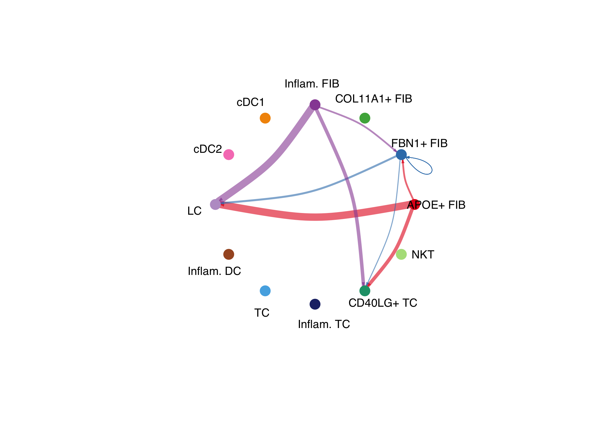<!-- -->

``` r
netVisual_heatmap(cellchat.NL, signaling = pathways.show, color.heatmap = "Reds") #CXCL as heatmap
```

```
## Do heatmap based on a single object
```

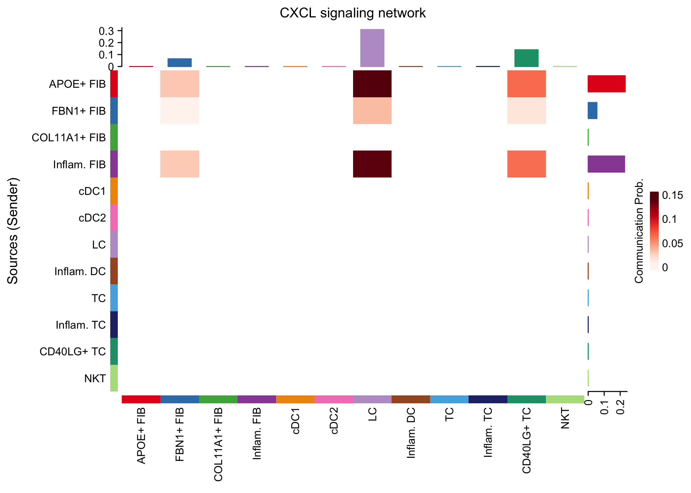<!-- -->

***Output interpretation***

The pathway-specific circle plot suggests that fibroblast populations (particularly APOE+ and Inflammatory FIB) act as potential CXCL signal senders, with Langerhans cells, FBN1+ fibroblasts and CD40LG+ T cells as receivers.

The heatmap supports this observation, highlighting strong CXCL-mediated communication toward LC and LC and CD40+ T cells coming from APOE+ and inflammatory fibroblasts.

These results suggests that fibroblast signaling may contribute to interactions between stromal and immune cell populations in nonlesional skin.

### (D) Ligand-receptors bubble plot

The `netVisual_bubble()` function allows us to explore these interactions between selected sender and receiver population. Here, we focus on signaling coming from fibroblast subpopulations toward immune cell population such as Langerhans cells and cDC2.

-   X-axis : sender-receiver cell population pairs

-   Y-axis : individual L-R interactions

-   Bubble color : inferred communication probability

-   Bubble size : statistical significance of the inferred interaction.

This visualization helps in identifying specific molecular interactions that may contribute to communication between selected cell population.


``` r
sources.use <- c("APOE+ FIB", "FBN1+ FIB", "COL11A1+ FIB", "Inflam. FIB") #select fibroblast populations as senders
targets.use <- c("LC", "cDC2") #select immune cell populations as receivers

netVisual_bubble(cellchat.NL, sources.use = sources.use, targets.use = targets.use, remove.isolate = TRUE)
```

```
## Comparing communications on a single object
```

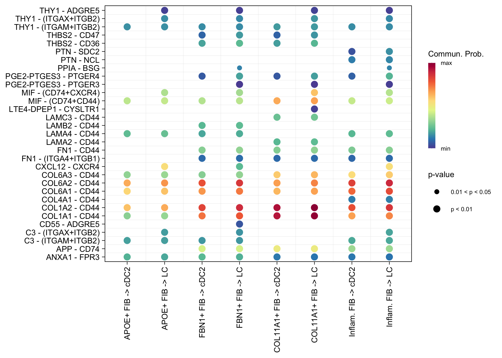<!-- -->

***Output interpretation***

This bubble plot provides a molecular-level view of inferred communication between fibroblast populations toward Langerhans cells and cDC2.

Many predicted interactions involve extracellular matrix components (collagen CD44 and laminin CD44). These interactions are detected across multiple fibroblast-immune cell pairs, suggetsing that extracellular matrix-associated signaling may contribute to communication between stromal and immune cell populations in nonlesional skin.

This visualization illustrates how CellChat links global communication patterns to specific ligand-receptor pairs that allow us to make hypotheses about molecular mechanisms underlying intercellular signaling.

**End of Step 7**

During this step, we explored cell-cell communication at three different levels :

-   Global network level : circle plots and heatmaps,

-   Signaling pathway level,

-   Molecular level : bubble plots.

All together, these visualizations provide a multi-level interpretation of cell-cell communication network in nonlesional skin.

## Step 8 : Exploring Signaling Roles and Saving Results

In the previous steps, we inferred and visualized cell-cell communication networks in nonlesional skin. CellChat can also characterize the functional roles of cell populations within signaling networks using concepts from graph theory.

### (A) Computing network centrality

For each inferred signaling pathway, CellChat computes network centrality measures to nvestigate how different populations contribute to the organization of communication.

These measures include :

-   Outgoing strength (total modeled signaling strength sent by a cellular population),

-   Incoming strength (total modeled signaling strength received by a cellular population),

-   Mediator role : the potential importance of a popualtion in connecting other populations within a signaling network,

-   Influence role : the influence of a population on network connectivity according to graph measures.

These roles describe the structure of inferred communication network, experimental results are needed to confirm possible biological function.

We use `slot.name = "netP"` because we aim to compute network centrality measures at the signaling pathway level.


``` r
cellchat.NL <- netAnalysis_computeCentrality(cellchat.NL, slot.name = "netP")

names(cellchat.NL@netP$centr)
```

```
##  [1] "COLLAGEN"      "MIF"           "CD45"          "LAMININ"      
##  [5] "FN1"           "APP"           "CypA"          "ANNEXIN"      
##  [9] "CXCL"          "Prostaglandin" "GALECTIN"      "CLDN"         
## [13] "THBS"          "THY1"          "COMPLEMENT"    "CLEC"         
## [17] "MHC-II"        "PTN"           "CD40"          "Cholesterol"  
## [21] "FGF"           "PDGF"          "ICAM"          "PLAU"         
## [25] "GAS"           "VCAM"          "ADGRE"         "CD80"         
## [29] "GAP"           "VEGF"          "LIGHT"         "JAM"          
## [33] "CSF"           "CysLTs"
```

``` r
#head(cellchat.NL@netP$centr$outdeg)

#centrality measures for the CXCL pathway
names(cellchat.NL@netP$centr[["CXCL"]]) #display centrality metrics available for CXCL pathway
```

```
##  [1] "outdeg_unweighted" "indeg_unweighted"  "outdeg"           
##  [4] "indeg"             "hub"               "authority"        
##  [7] "eigen"             "page_rank"         "betweenness"      
## [10] "flowbet"           "info"
```

``` r
cellchat.NL@netP$centr[["CXCL"]]$outdeg #display outgoing signaling strength for CXCL pathway
```

```
##    APOE+ FIB    FBN1+ FIB COL11A1+ FIB  Inflam. FIB         cDC1         cDC2 
##   0.23143444   0.05461192   0.00000000   0.22749369   0.00000000   0.00000000 
##           LC   Inflam. DC           TC   Inflam. TC   CD40LG+ TC          NKT 
##   0.00000000   0.00000000   0.00000000   0.00000000   0.00000000   0.00000000
```

``` r
cellchat.NL@netP$centr[["CXCL"]]$indeg #incoming signaling strength for CXCL
```

```
##    APOE+ FIB    FBN1+ FIB COL11A1+ FIB  Inflam. FIB         cDC1         cDC2 
##   0.00000000   0.06433728   0.00000000   0.00000000   0.00000000   0.00000000 
##           LC   Inflam. DC           TC   Inflam. TC   CD40LG+ TC          NKT 
##   0.30903113   0.00000000   0.00000000   0.00000000   0.14017164   0.00000000
```

***Output interpretation***

The computed network centrality measures are stored in the `cellchat.NL@netP$centr` list organized by signaling pathway. Each pathway contains several centrality metrics such as outgoing and incoming signaling strength. These measures allow us to characterize potential role of cell population within inferred signaling pathways.

The pathway specific centrality shows that CXCL signaling network is driven by a limited subset of cell populations in nonlesional skin. APOE+ and inflammatory fibroblasts display the highest outgoing signaling strengths, indicating that they are the main predicted senders of CXCL-mediated communication. FBN1+ fibroblasts also contributes but to a smaller amount. Langerhans cells show the highest incoming signaling strength, suggesting that they are the main predicted receivers in CXCL signaling. CD40LG+ T cells also seems to be an important receiver. FBN1+ fibroblasts show both sending and receiving activity.

These results suggest that fibroblast-derived CXCL signaling may target immune populations such as LC and CD40LG+ T cells in nonlesional skin.

### (B) Visualizing sender and receiver roles

We can now visualize the overall signaling roles of the annotated cell populations.

The `netAnalysis_signalingRole_scatter()`function summarizes outgoing and incoming communication strengths across the inferred signaling pathways.

In this representation :

-   the X-axis represents the overall outgoing signaling strength,

-   the Y-axis represents the overall incoming signaling strength.

Cell populations positioned toward the right exhibit stronger predicted outgoing signaling and populations positioned toward the top receive stronger incoming signaling. Populations with high values on both axes may participate in both sending and receiving signals.

This analysis complements the interaction counts obtained in Step 6 by focusing on communication strength rather than the number of interactions alone.


``` r
netAnalysis_signalingRole_scatter(cellchat.NL, title = "Signaling roles in non-lesional skin")
```

```
## Signaling role analysis on the aggregated cell-cell communication network from all signaling pathways
```

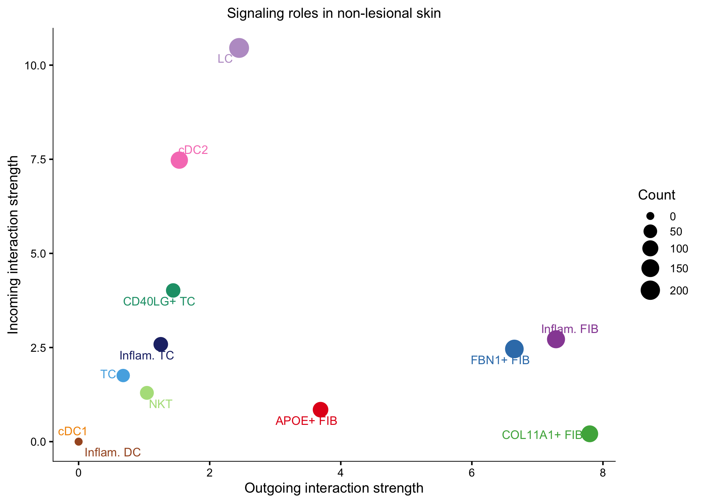<!-- -->

``` r
#signaling roles specifically for CXCL
pathways.show <- "CXCL"
netAnalysis_signalingRole_scatter(cellchat.NL, signaling = pathways.show, title = "CXCL signaling roles in non-lesional skin")
```

```
## Signaling role analysis on the cell-cell communication network from user's input
```

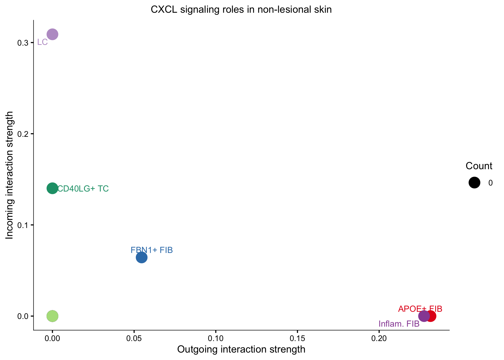<!-- -->

***Output interpretation***

Fibroblast populations such as COL11A1+, Inflammatory and FBN1+ show high outgoing signaling strengths, suggesting that they may act as major signal senders within the inferred communication network.

COL11A1+ fibroblasts exhibits the highest outgoing signaling strength despite having fewer outgoing interaction than inflammatory fibroblasts in Step 6.

Langerhans cells exhibits the highest incoming signaling strength, followed by cDC2. This suggets that these populations may as major receivers of predicted signals.

Compared with the golbal signaling role analysis, the CXCL specific scatter plot highlights a more restricted communication structure. This shows that the signaling roles of cell populations can vary depending on the pathway considered.

All these results suggest that fibroblasts act as major senders and antigen-presenting immune cells act as major receivers. Experimental results are still needed to assess this.

### (C) Saving results and ensuring reproducibility

To ensure reproducibility and facilitate downstream analysis, we save the processed CellChat object and the inferred communication results.

The .rds format preserves the complete R object (including expression data, inferred communication probabilites, signaling pathways involved and network analysis results). Saving this object is strongly adviced as communication inference can be computationally intensive.

We also choose to export inferred L-R interactions as a .csv file for easier inspection. We also save the R session information and packages versions used here.

The saved object will be reused in Part 2 - Comparative Analysis.


``` r
saveRDS(cellchat.NL, file = "./02_RESULTS/cellchat_NL.rds") #complete analyzed cellchat object
write.csv(df.net.NL, file = "./02_RESULTS/CellChat_NL_interactions.csv", row.names = FALSE) #export inferred l-r communications
write.csv(network.table.NL, file = "./02_RESULTS/CellChat_NL_network_summary.csv", row.names = FALSE) #export summary of outgoing/incoming interactions
writeLines(capture.output(sessionInfo()), con = "./02_RESULTS/session_info.txt") #export R and packages versions
list.files("02_RESULTS") #check is saving is OK
```

```
## [1] "CellChat_LS_interactions.csv"    "CellChat_LS_network_summary.csv"
## [3] "cellchat_LS.rds"                 "CellChat_NL_interactions.csv"   
## [5] "cellchat_NL_LS_merged.rds"       "CellChat_NL_LS_summary.csv"     
## [7] "CellChat_NL_network_summary.csv" "cellchat_NL.rds"                
## [9] "session_info.txt"
```

**End of Step 8**

Network centrality analysis allowed us to identify the main predicted signal senders and receivers in nonlesional skin.

While fibroblasts populations contribute to outgoing signaling, Langerhans cells act as major receivers. The CXCL specific analysis desmonstrate that signaling roles vary depending on the pathway considered.

**END OF PART 1**

In this first part, we successfully applied the complete CellChat workflow to nonlesional human skin, from data preparation to the inference and visualization of cell-cell communication networks.

In Part 2, we will extend this analysis to lesional skin and compare both conditions to explore changes in cell-cell communication.

# Part 2 - Going further : comparative analysis between two conditions

## Step 1 : CellChat analysis of lesional skin

The whole pipeline ran in Part 1 is done on lesional skin.

### (A) Selecting and Initinializing the lesional dataset


``` r
cell.use.LS <- rownames(meta)[meta$condition == "LS"]
data.input.LS <- data.input[  , cell.use.LS, drop = FALSE]
meta.LS <- meta[cell.use.LS, , drop = FALSE]

stopifnot(identical(colnames(data.input.LS), rownames(meta.LS)))

dim(data.input.LS)
```

```
## [1] 17328  5011
```

``` r
table(meta.LS$labels)
```

```
## 
##    APOE+ FIB    FBN1+ FIB COL11A1+ FIB  Inflam. FIB         cDC1         cDC2 
##         1228          813          181          484          121          294 
##           LC   Inflam. DC           TC   Inflam. TC   CD40LG+ TC          NKT 
##           67           81          765          266          630           81
```

``` r
cellchat.LS <- createCellChat(object = data.input.LS, meta = meta.LS, group.by = "labels")
```

```
## [1] "Create a CellChat object from a data matrix"
## Set cell identities for the new CellChat object 
## The cell groups used for CellChat analysis are  APOE+ FIB, FBN1+ FIB, COL11A1+ FIB, Inflam. FIB, cDC1, cDC2, LC, Inflam. DC, TC, Inflam. TC, CD40LG+ TC, NKT
```

``` r
stopifnot(ncol(cellchat.LS@data) == 5011)

cellchat.LS
```

```
## An object of class CellChat created from a single dataset 
##  17328 genes.
##  5011 cells. 
## CellChat analysis of single cell RNA-seq data!
```

***Output interpretation***

The lesional skin dataset contains 17 328 genes and 5 011 cells distributed across 12 annotated cell populations.

Unlike the NL dataset, all cell population contain at least 10 cells.


### (B) Inferring cell-cell communication in lesional skin


``` r
cellchat.LS@DB <- CellChatDB
cellchat.LS <- subsetData(cellchat.LS)

cellchat.LS <- identifyOverExpressedGenes(cellchat.LS)
cellchat.LS <- identifyOverExpressedInteractions(cellchat.LS)
```

```
## The number of highly variable ligand-receptor pairs used for signaling inference is 1645
```

``` r
cellchat.LS <- computeCommunProb(cellchat.LS, type = "triMean", population.size = FALSE, nboot = 100, seed.use = 28)
```

```
## triMean is used for calculating the average gene expression per cell group. 
## [1] ">>> Run CellChat on sc/snRNA-seq data <<< [2026-10-16 03:26:12.080836]"
## [1] ">>> CellChat inference is done. Parameter values are stored in `object@options$parameter` <<< [2026-10-16 03:27:04.821994]"
```

``` r
cellchat.LS <- filterCommunication(cellchat.LS, min.cells = 10)

cellchat.LS <- computeCommunProbPathway(cellchat.LS)

cellchat.LS <- aggregateNet(cellchat.LS)

cellchat.LS <- netAnalysis_computeCentrality(cellchat.LS, slot.name = "netP")


length(cellchat.LS@netP$pathways)
```

```
## [1] 33
```

``` r
dim(cellchat.LS@net$count)
```

```
## [1] 12 12
```

``` r
dim(cellchat.LS@net$weight)
```

```
## [1] 12 12
```

``` r
df.net.LS <- subsetCommunication(cellchat.LS, thresh = 0.05)

nrow(df.net.LS)
```

```
## [1] 993
```

``` r
head(df.net.LS)
```

```
##         source    target ligand receptor        prob pval interaction_name
## 1    APOE+ FIB APOE+ FIB   FGF7    FGFR1 0.006276293    0       FGF7_FGFR1
## 2    FBN1+ FIB APOE+ FIB   FGF7    FGFR1 0.004854738    0       FGF7_FGFR1
## 3 COL11A1+ FIB APOE+ FIB   FGF7    FGFR1 0.003575889    0       FGF7_FGFR1
## 4    APOE+ FIB FBN1+ FIB   FGF7    FGFR1 0.009362611    0       FGF7_FGFR1
## 5    FBN1+ FIB FBN1+ FIB   FGF7    FGFR1 0.007247115    0       FGF7_FGFR1
## 6 COL11A1+ FIB FBN1+ FIB   FGF7    FGFR1 0.005341442    0       FGF7_FGFR1
##   interaction_name_2 pathway_name         annotation     evidence
## 1       FGF7 - FGFR1          FGF Secreted Signaling PMC: 4393358
## 2       FGF7 - FGFR1          FGF Secreted Signaling PMC: 4393358
## 3       FGF7 - FGFR1          FGF Secreted Signaling PMC: 4393358
## 4       FGF7 - FGFR1          FGF Secreted Signaling PMC: 4393358
## 5       FGF7 - FGFR1          FGF Secreted Signaling PMC: 4393358
## 6       FGF7 - FGFR1          FGF Secreted Signaling PMC: 4393358
```

***Output interpretation***

CellChat identified 1 645 candidate L-R interactions in lesional skin, resulting in 993 inferred communications after statistical filtering.

These interactions are aggregated in 33 signaling pathways and global communication network is represented by two 12x12 matrices summarizing interaction counts and strengths.

The first extracted interactions involve FGF7-FGFR1 signaling between fibroblast populations showing potential autocrine and paracrine communication.

### (C) Visualization on lesional skin

**Global circle plot**


``` r
groupSize.LS <- as.numeric(table(cellchat.LS@idents)) #number of cells in each population

par(mfrow = c(1,2), xpd = TRUE) #display the 2 circle plots side by side

#Plot number of inferred interactions
netVisual_circle(cellchat.LS@net$count, vertex.weight = groupSize.LS, weight.scale = TRUE, label.edge = FALSE, title.name = "Number of interactions")

#Plot total inferred communication strength
netVisual_circle(cellchat.LS@net$weight, vertex.weight = groupSize.LS, weight.scale = TRUE, label.edge = FALSE, title.name = "Interaction strength")
```

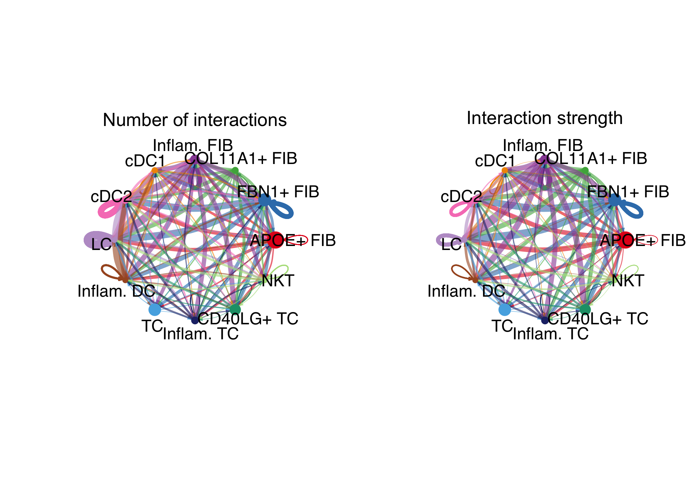<!-- -->

``` r
par(mfrow = c(1,1))
```

***Output interpretation***

The circle plots reveal a particular dense network of predicted cell-cell communications in lesional skin. 

Fibroblast subpopulations display prominent outgoing interactions while Langerhans cells and cDC2 appear to be major receiving populations.

**Heatmaps**


``` r
netVisual_heatmap(cellchat.LS, measure = "count", color.heatmap = "Blues") #interaction count
```

```
## Do heatmap based on a single object
```

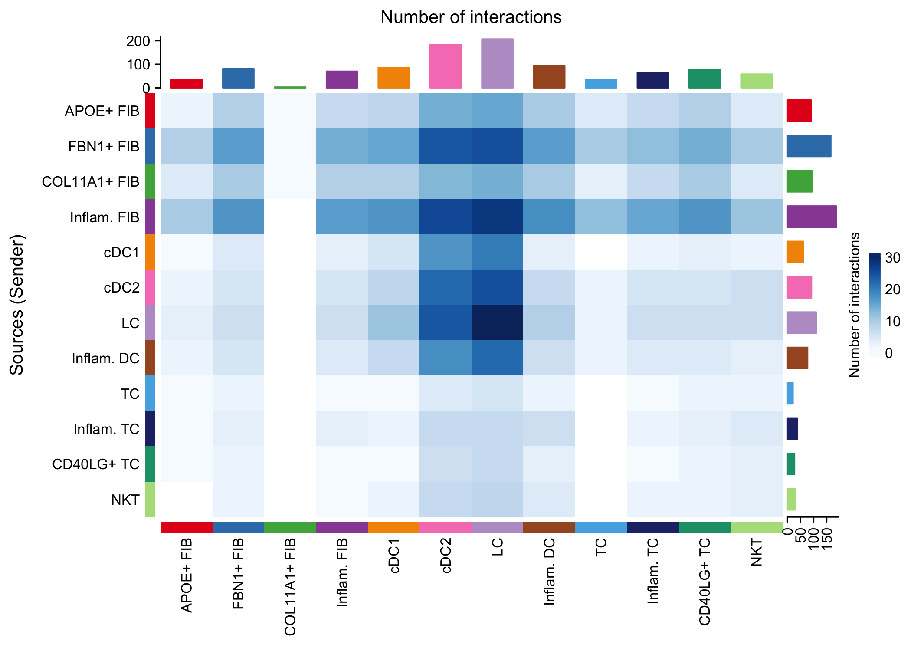<!-- -->

``` r
netVisual_heatmap(cellchat.LS, measure = "weight", color.heatmap = "Reds") #aggregated interaction strengths
```

```
## Do heatmap based on a single object
```

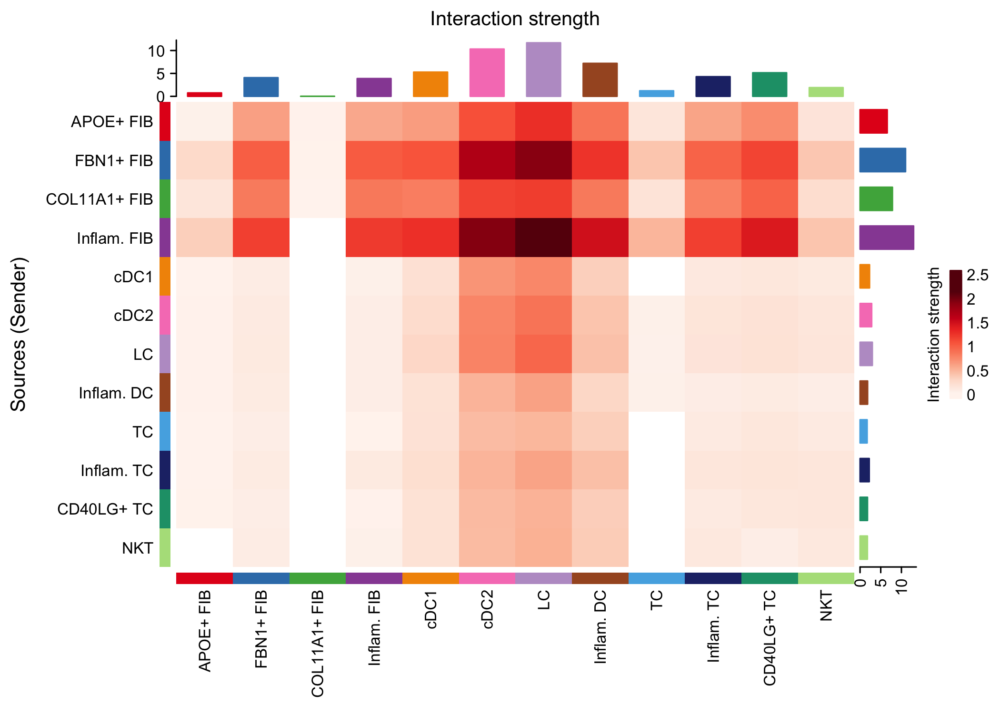<!-- -->

***Output interpretation***

The heatmaps show strong predicted communication from fibroblast populations toward LC and cDC2, both in terms of interaction number and aggregated strength. Inflammatory and FBN1+ fibroblasts show prominent outgoing signaling. 

Unlike the NL analysis, communications involving cDC1 and inflammatory dendritic cells are retained.


**Pathway specific communication network**


``` r
#Select a specific pathway 
pathways.show <- "CXCL"

stopifnot((pathways.show %in% cellchat.LS@netP$pathways)) #verify if pathway is inferred

netVisual_aggregate(cellchat.LS, signaling = pathways.show, layout = "circle") #CXCL as circle plot
```

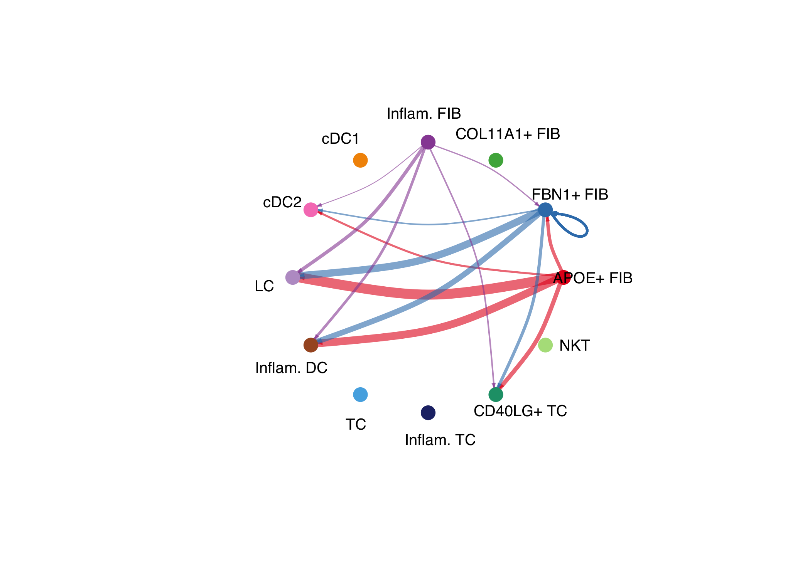<!-- -->

``` r
netVisual_heatmap(cellchat.LS, signaling = pathways.show, color.heatmap = "Reds") #CXCL as heatmap
```

```
## Do heatmap based on a single object
```

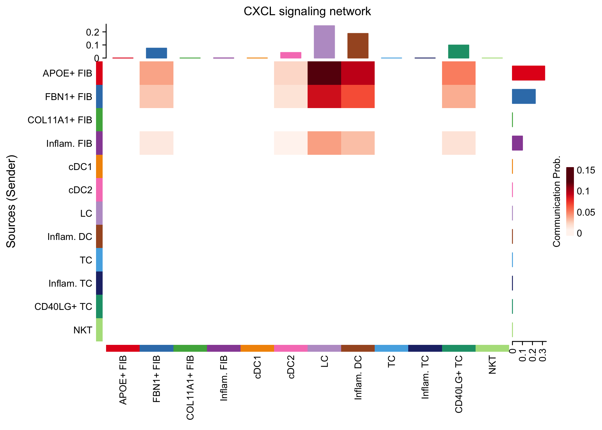<!-- -->

***Output interpretation***

The CXCL specific network reveals communication originating from APOE+, FBN1+ and inflammatory fibroblasts.

Langerhans cells and inflammatory dendritic cells emerge as an important predicted receivers with addional signaling toward CD40LG+ T cells and cDC2.

This suggests potential fibroblast-mediated chemokine signaling toward immune cell populations in lesional skin.

**Bubble plot**


``` r
sources.use <- c("APOE+ FIB", "FBN1+ FIB", "COL11A1+ FIB", "Inflam. FIB") #select fibroblast populations as senders
targets.use <- c("LC", "cDC2") #select immune cell populations as receivers

netVisual_bubble(cellchat.LS, sources.use = sources.use, targets.use = targets.use, remove.isolate = TRUE)
```

```
## Comparing communications on a single object
```

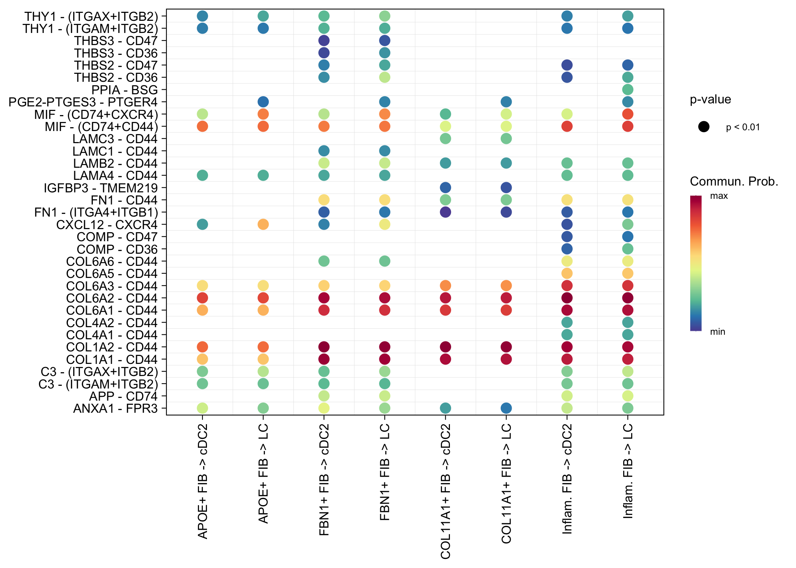<!-- -->

***Output interpretation***

The bubble plot reveal predicted interactions between fibroblast populations and immune cells involving collagen-CD44, laminin-CD44, MIF-CD74 and CXCL12-CXCR4.

Extracellular matrix associated interactions are prominent across fibroblast-immune cell pairs.

These results provide molecular candidates that may contribute to stromal-immune communication in lesional skin.


**Network centrality and signaling roles**


``` r
cellchat.LS <- netAnalysis_computeCentrality(cellchat.LS, slot.name = "netP")

names(cellchat.LS@netP$centr)
```

```
##  [1] "COLLAGEN"      "MIF"           "LAMININ"       "FN1"          
##  [5] "MHC-II"        "ANNEXIN"       "CypA"          "GALECTIN"     
##  [9] "APP"           "CXCL"          "CD45"          "COMPLEMENT"   
## [13] "THBS"          "Prostaglandin" "CLDN"          "THY1"         
## [17] "CLEC"          "ICAM"          "FGF"           "CD40"         
## [21] "TNF"           "CCL"           "GAS"           "IL4"          
## [25] "IGFBP"         "JAM"           "VCAM"          "CD80"         
## [29] "LIGHT"         "CADM"          "CSF"           "VEGF"         
## [33] "GAP"
```

``` r
#head(cellchat.LS@netP$centr$outdeg)

#centrality measures for the CXCL pathway
names(cellchat.LS@netP$centr[["CXCL"]]) #display centrality metrics available for CXCL pathway
```

```
##  [1] "outdeg_unweighted" "indeg_unweighted"  "outdeg"           
##  [4] "indeg"             "hub"               "authority"        
##  [7] "eigen"             "page_rank"         "betweenness"      
## [10] "flowbet"           "info"
```

``` r
cellchat.LS@netP$centr[["CXCL"]]$outdeg #display outgoing signaling strength for CXCL pathway
```

```
##    APOE+ FIB    FBN1+ FIB COL11A1+ FIB  Inflam. FIB         cDC1         cDC2 
##    0.3220750    0.2281327    0.0000000    0.1000529    0.0000000    0.0000000 
##           LC   Inflam. DC           TC   Inflam. TC   CD40LG+ TC          NKT 
##    0.0000000    0.0000000    0.0000000    0.0000000    0.0000000    0.0000000
```

``` r
cellchat.LS@netP$centr[["CXCL"]]$indeg #incoming signaling strength for CXCL
```

```
##    APOE+ FIB    FBN1+ FIB COL11A1+ FIB  Inflam. FIB         cDC1         cDC2 
##   0.00000000   0.07512456   0.00000000   0.00000000   0.00000000   0.04203888 
##           LC   Inflam. DC           TC   Inflam. TC   CD40LG+ TC          NKT 
##   0.24663931   0.18750849   0.00000000   0.00000000   0.09894938   0.00000000
```


``` r
netAnalysis_signalingRole_scatter(cellchat.LS, title = "Signaling roles in lesional skin")
```

```
## Signaling role analysis on the aggregated cell-cell communication network from all signaling pathways
```

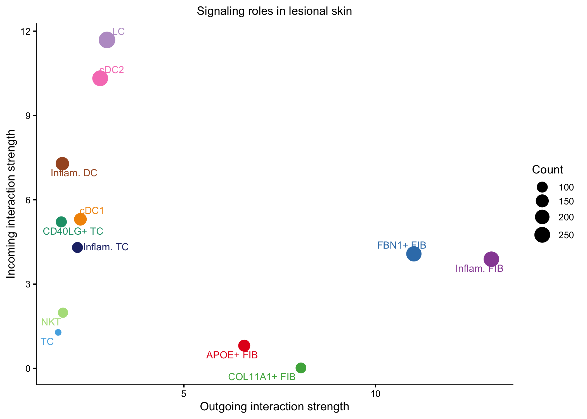<!-- -->

``` r
#signaling roles specifically for CXCL
pathways.show <- "CXCL"
netAnalysis_signalingRole_scatter(cellchat.LS, signaling = pathways.show, title = "CXCL signaling roles in lesional skin")
```

```
## Signaling role analysis on the cell-cell communication network from user's input
```

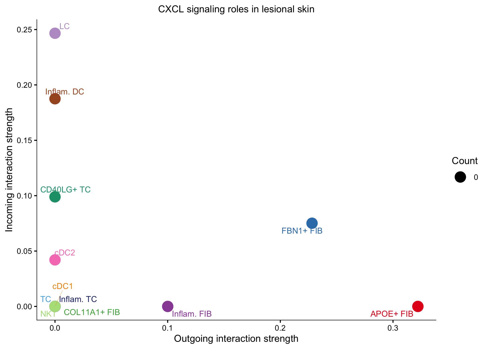<!-- -->

***Output interpretation***

Global signaling role analysis identifies inflammatory and FBN1+ fibroblasts as major predicted signal senders in lesional skin.

Langerhans cells and cDC2 exhibit strongest incoming signaling, while inflammatory dendritic cells also show strong receiving activity.

These patterns suggest distinct signaling roles between fibroblast and immune cell populations within the inferred network.

The CXCL specific analysis identifies APOE+ fibroblasts as the main predicted signal senders, followed by FBN1+ fibroblasts. Langerhans cells display the highest incoming CXCL signaling strength followed by inflammatory dendritic cells. 


### (D) Summarize and save results for lesional skin


``` r
outgoing.LS <- rowSums(cellchat.LS@net$count)
incoming.LS <- colSums(cellchat.LS@net$count)

network.table.LS <- data.frame(cell_population = names(outgoing.LS), outgoing = as.numeric(outgoing.LS), incoming = as.numeric(incoming.LS))
network.table.LS <- network.table.LS[order(-network.table.LS$outgoing), ]
network.table.LS
```

```
##    cell_population outgoing incoming
## 4      Inflam. FIB      187       70
## 2        FBN1+ FIB      166       81
## 7               LC      110      207
## 3     COL11A1+ FIB       94        3
## 6             cDC2       92      182
## 1        APOE+ FIB       90       36
## 8       Inflam. DC       77       94
## 5             cDC1       60       86
## 10      Inflam. TC       38       64
## 12             NKT       31       58
## 11      CD40LG+ TC       27       77
## 9               TC       21       35
```

``` r
saveRDS(cellchat.LS, file = "./02_RESULTS/cellchat_LS.rds")

write.csv(df.net.LS, file = "./02_RESULTS/CellChat_LS_interactions.csv", row.names = FALSE)

write.csv(network.table.LS, file = "./02_RESULTS/CellChat_LS_network_summary.csv", row.names = FALSE)
```

**End of Step 1**

We applied the CellChat workflow for lesional skin, identifying predicted communication networks involving fibroblast and immune cell populations.

The results obtained provide the basis for our next step, where NL and LS communication network will be compared in order to investigate condition-associated differences.


## Step 2 : Merging the lesional and nonlesional CellChat objects

### (A) Verifying dataset compatibility

Before merging the CellChat objects, we verify that they both contain the expected number of cells and share the same annotated cell populations.


``` r
# Verify that both conditions are available
stopifnot(ncol(cellchat.NL@data) == 2552, ncol(cellchat.LS@data) == 5011)
# Compare annotated cell populations
table(cellchat.NL@idents)
```

```
## 
##    APOE+ FIB    FBN1+ FIB COL11A1+ FIB  Inflam. FIB         cDC1         cDC2 
##         1215          548          196           69            7           38 
##           LC   Inflam. DC           TC   Inflam. TC   CD40LG+ TC          NKT 
##           20            1          212           44          166           36
```

``` r
table(cellchat.LS@idents)
```

```
## 
##    APOE+ FIB    FBN1+ FIB COL11A1+ FIB  Inflam. FIB         cDC1         cDC2 
##         1228          813          181          484          121          294 
##           LC   Inflam. DC           TC   Inflam. TC   CD40LG+ TC          NKT 
##           67           81          765          266          630           81
```

``` r
# Check whether cell population names are identical
setequal(levels(cellchat.NL@idents), levels(cellchat.LS@idents))
```

```
## [1] TRUE
```

***Output interpretation***

`setequal()`function confirms that the same cell population labels are present in both condition to allow comparaison of corresponding cell groups.

Populations size differ between NL and LS and two populations were filtered only in NL. These differences must be considered when interpreting results.


### (B) Merging the CellChat objects

We can now merge the analyzed NL and LS CellChat objects using `mergeCellChat()`. This function combines the results into a single object for comparative analysis while preserving the communication networks inferred for each condition.

`add.names` argument assigns a label to each dataset so that CellChat can distinguish NL from LS skin.


``` r
object.list <- list(NL = cellchat.NL, LS = cellchat.LS) #create named list of cellchat objects

cellchat.merged <- mergeCellChat(object.list, add.names = names(object.list))
```

```
## Merge the following slots: 'data.signaling','images','net', 'netP','meta', 'idents', 'var.features' , 'DB', and 'LR'.
```

``` r
cellchat.merged
```

```
## An object of class CellChat created from a merged object with multiple datasets 
##  1093 signaling genes.
##  7563 cells. 
## CellChat analysis of single cell RNA-seq data!
```
***Output Interpretation***

The NL and LS CellChat objects were successfully merged into a single object containing 7 563 cells and 1 093 signaling genes.

The merged object preserves the inferred communication networks for both conditions, allowing comparaison.

### (C) Save the merged CellChat object


``` r
saveRDS(cellchat.merged, file = "./02_RESULTS/cellchat_NL_LS_merged.rds")
```


**End of Step 2**

Now that we created the merged CellChat object, we can move on with the comparaison.


## Step 3 : Comparing the number and strength of interactions


### (A) Comparing the total number of inferred interactions

We first compare the total number of inferred L-R communication between NL and LS skin. 

`compareInteractions()`function summarizes the number of inferred interactions in each condition using the aggregated communication networks.

NB : Differences in cell numbers and population composition may influence the number of inferred interactions.


``` r
p.count <- compareInteractions(cellchat.merged, show.legend = FALSE, group = c(1,2))
p.count
```

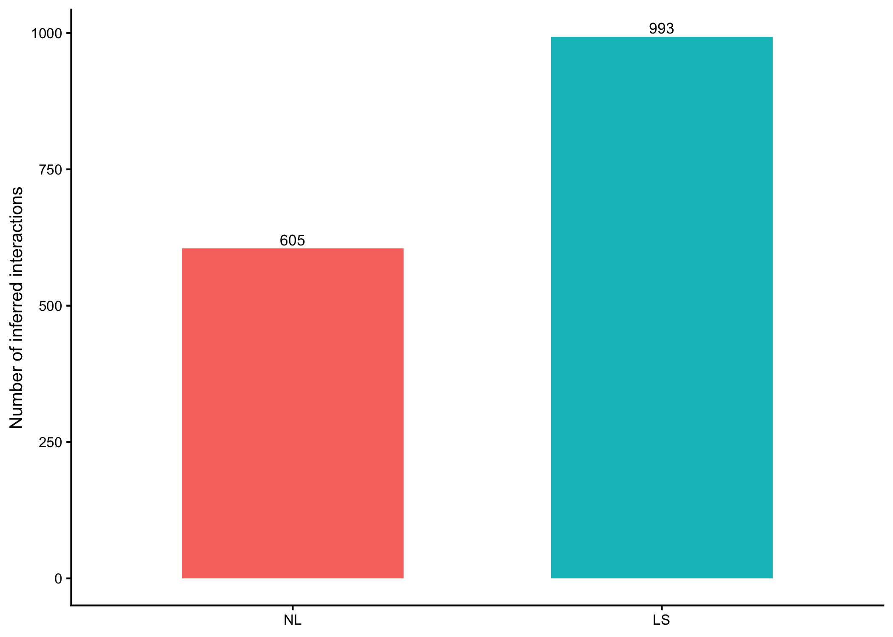<!-- -->

***Output Interpretation***

NL condition contains 605 inferred interactions, while LS contains 993 inferred interactions.


### (B) Comparing overall communication strength

We now compare the overall inferred communication strength. 

Interaction strength reflects the sum of their modeled communication scores. 

We use `measure = "weight"` to compare aggregated strength across our two conditions.

This help us determine whether a condition shows stronger predicted signaling.


``` r
p.weight <- compareInteractions(cellchat.merged, show.legend = FALSE, group = c(1,2), measure = "weight")
p.weight
```

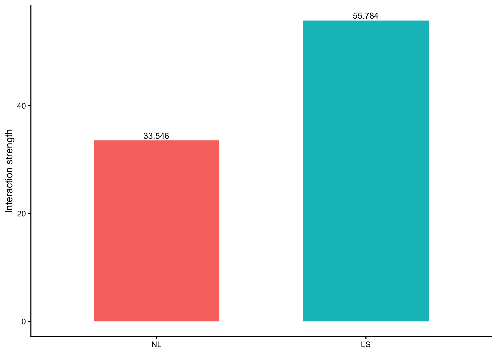<!-- -->

***Output Interpretation***

The total inferred communication strength is higher in LS than in NL skin, indicating stronger aggregated signaling scores in LS network.

These results suggest increased predicted communication in lesional skin. But, this difference must be interpreted cautiously as the two conditions differ in cell number and population.


### (C) Visualizing differential communication networks

To identify changes in communication between specific cell populations, we visualize differential networks using `netVisual_diffInteraction()`. This function compares the inferred networks between NL and LS skin and assess changes in either interaction counts or aggregated communication strength.

As the datasets were merged in the order NL -> LS :

- Red edges indicated increased inferred communication in LS compared with NL,

- Blue edges indicate decrased inferred communication in LS compared with NL.

NB : These differences are only descriptive.


``` r
par(mfrow = c(1,2), xpd = TRUE)
#difference in number of interactions
netVisual_diffInteraction(cellchat.merged, comparison = c(1, 2), weight.scale = TRUE, measure = "count")
#difference in aggregated communication strength
netVisual_diffInteraction(cellchat.merged, comparison = c(1,2), weight.scale = TRUE, measure = "weight")
```

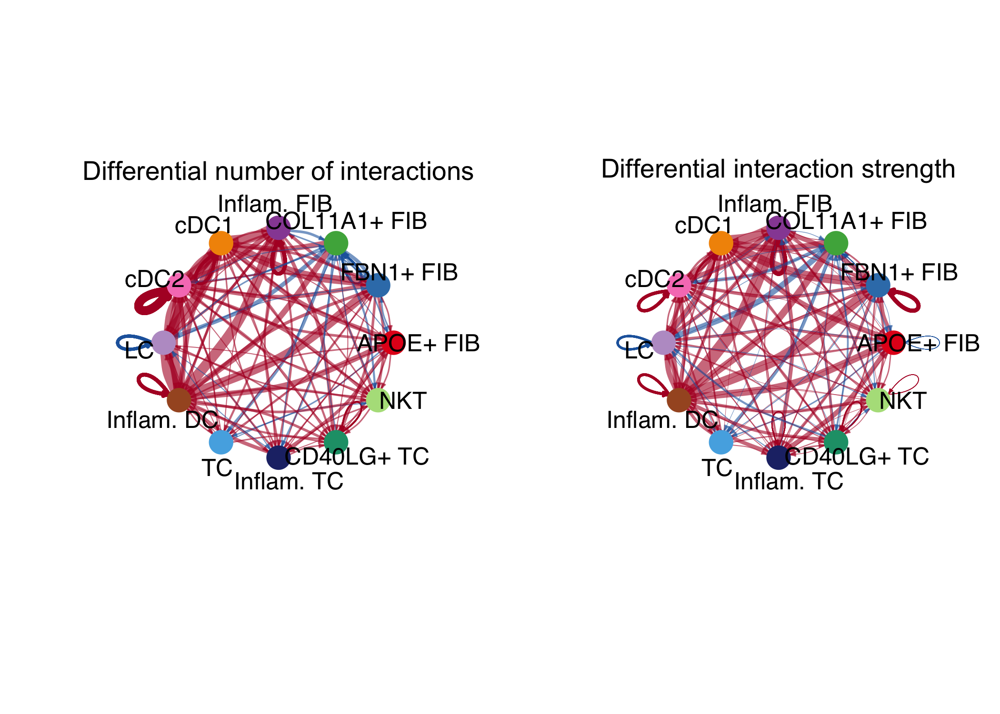<!-- -->

***Output Interpretation***

The differential networks show a predominance of red edges, indicating increased inferred interaction counts and communication strengths in LS compared to NL.

Several blue edges indicate that some communication are reduced in lesional skin, suggesting that network changes may not be the same across all cell populations (for example Langerhans cells).

NB : These results are only descriptive and may not be statistically relevant.


**End of Step 3**

We compared the total number and aggregated strength of inferred communication between NL and LS skin.

Differential network visualizations allow us to identify which cell population pairs show increased or decreased predicted communication in lesional skin. 

These analyses must be interpreted considering the differences in cell numbers between conditions and population composition.


## Step 4 : Identifying differences in signaling pathways between conditions

The goal here is to move from the overall differences observed in Step 3 to a more specific biological question : which signaling pathways contribute differentially to the communications inferred in NL and LS ?

### (A) Comparing signaling pathway activity between conditions

We now investigate which signaling pathways contribute to these differences.

`rankNet()`function compares pathway-level information flow, defined as the sum of inferred communication probabilities across all sender-receiver population pairs within each pathway.

This allows us to identify signaling pathways with higher or lower predicted communication strength in LS compared to NL.

We choose to set `stacked = FALSE` because it makes it easier to see the differences between NL and LS. 

`do.stat = TRUE` test if the difference in signaling pathway activity is significant between our two conditions.


``` r
p.pathways <- rankNet(cellchat.merged, mode = "comparison", measure = "weight", stacked = FALSE, do.stat = TRUE)
p.pathways
```

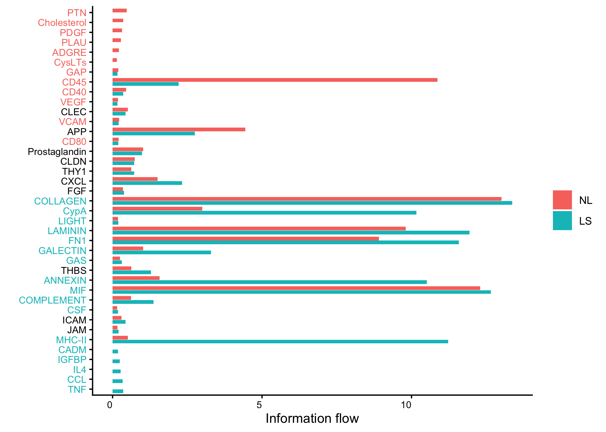<!-- -->

***Output Interpretation***

This comparison reveals distinct signaling patterns between our two conditions.

Pathways such as MHC-II, ANNEXIN and CypA exhibit higher inferred information flow in LS, while CD45 and VCAM show stronger predicted communication in NL condition. Some pathways, like COLLAGEN and MIF contribute to both conditions.

Several pathways are detected in one condition only (PTN, CADM, IL4...) suggesting condition-specific signaling patterns.

These differences suggest a potential reorganization of intercellular communication in lesional skin (still exploratory results, may be influenced by differences in cell composition). 

### (B) Focusing on CXCL signaling pathway

To illustrate pathway-specific changes, we focus on CXCL signaling as it was previously examined in both conditions.

The total CXCL communication strength is computed by summing the inferred pathway-level communication probabilites across all sender-receiver population pairs.

This provides a quantitative comparaison of CXCL-mediated signaling between NL and LS skin.


``` r
#calculate total communication strength
cxcl.NL <- sum(cellchat.NL@netP$prob[, , "CXCL"])
cxcl.LS <- sum(cellchat.LS@netP$prob[, , "CXCL"])

cxcl.comparison <- data.frame(condition = c("NL", "LS"), strength = c(cxcl.NL, cxcl.LS))
cxcl.comparison
```

```
##   condition  strength
## 1        NL 0.5135400
## 2        LS 0.6502606
```

``` r
#visualize CXCL communication strength
p.cxcl <- ggplot(cxcl.comparison, aes(x = condition, y = strength, fill = condition)) +
  geom_col(width = 0.6) +
  labs(title = "CXCL signaling: NL vs LS", x = "Skin condition", y = "Total inferred CXCL communication strength") +
  theme_classic() +
  theme(legend.position = "none")
p.cxcl
```

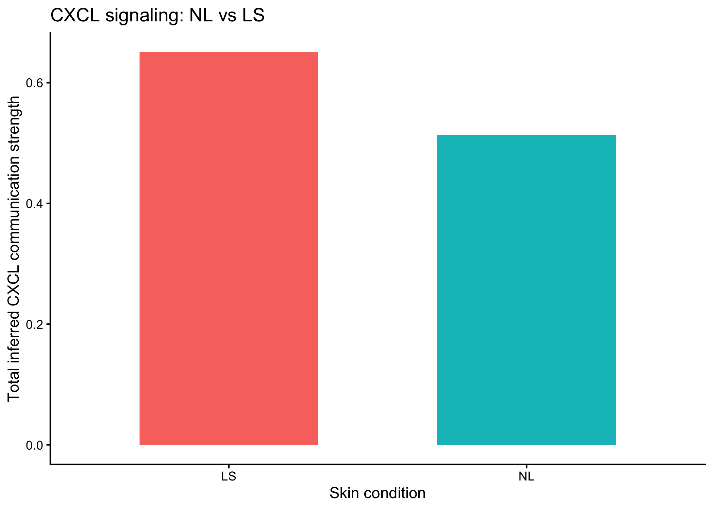<!-- -->

***Output Interpretation***

The total inferred CXCL communication strength is higher in lesional skin (0.650) than in nonlesional skin (0.514), representing a 27% increase.

This suggests enhanced predicted CXCL-mediated communication in LS and may reflect changes in fibroblast-immune cell signaling.

This difference is descriptive and does not establish a statistically significant increase in biological CXCL activity.

**End of Step 4**

By comparing pathway-level information, we identified potential difference in intercellular signaling between NL and LS skin. CXCL pathway provides a focused example of how condition-specific communication patterns can be explored beyond global network comparisons.

## Step 5 : Interpreting condition-specific communication patterns and discuss limitations

### (A) Summary of NL vs LS communication differences


``` r
#summary table comparing NL and LS
comparison.summary <- data.frame(Metric = c("Number of cells", "Candidate ligand-receptor pairs", "Inferred communication records", "Inferred signaling pathways", "Total communication strength", "CXCL communication strength"),
NL = c(ncol(cellchat.NL@data), nrow(cellchat.NL@LR$LRsig), nrow(df.net.NL), length(cellchat.NL@netP$pathways), sum(cellchat.NL@net$weight),cxcl.NL),
LS = c(ncol(cellchat.LS@data), nrow(cellchat.LS@LR$LRsig), nrow(df.net.LS), length(cellchat.LS@netP$pathways), sum(cellchat.LS@net$weight), cxcl.LS))

#display a formatted table in R Markdown
knitr::kable(comparison.summary, digits = 3, caption = "Summary of CellChat results: NL vs LS")
```


Table: Summary of CellChat results: NL vs LS

|Metric                          |       NL|       LS|
|:-------------------------------|--------:|--------:|
|Number of cells                 | 2552.000| 5011.000|
|Candidate ligand-receptor pairs | 1351.000| 1645.000|
|Inferred communication records  |  605.000|  993.000|
|Inferred signaling pathways     |   34.000|   33.000|
|Total communication strength    |   33.546|   55.784|
|CXCL communication strength     |    0.514|    0.650|

``` r
write.csv(comparison.summary, "02_RESULTS/CellChat_NL_LS_summary.csv", row.names = FALSE)
```

***Interpretation***

Our comparative analysis suggests a reorganization of inferred cell-cell communication networks between nonlesional and lesional skin.

Lesional skin exhibits a higher number of predicted interactions and overall communication strength. But, these changes are not uniform across signaling pathways.

For instance, MHC-II, FN1 and ANNEXIN signaling show greater information flow in LS, while CD45 signaling is stronger in NL.

CXCL communication strength is approximatively 27% higher in LS, suggesting potential changes in chemokine-mediated interactions between stromal and immune cell populations.


### (B) Limitations of the comparative analysis

Several limitations should be considered when interpreting the results obtained. 

First of all, NL and LS contain different number of cells (2 552 VS 5 011), which may influence communication inference. Moreover, cDC1 and inflammatory dendritic cells were excluded from the NL network due to insufficient cell numbers but retained in LS.

Secondly, the comparison is only exploratory and does not account for biological variability between our conditions.

Finally, CellChat infers potential signaling from gene expression and known L-R interactions without mesuring protein abundance, receptor activation or physical cell proximity.

Therefore, these findings require further experimental validation.

### (C) Final tutorial conclusion

This tutorial demonstrated how CellChat v2 can be used to infer, visualize and compare cell-cell communication networks from scRNA-seq data.

The overall analysis highlighted the potential role of fibroblast populations as major signal senders and antigen presenting immune cells such as Langerhans cells as major receivers in human skin.

Our exploratory comparison suggested changes in global communication strength and CXCL pathway signaling between NL and LS conditions.

CellChat provides a powerful framework for generation hypotheses about intercellular communication, while emphasizing the importance of paramater selection and biological interpretation.


***Thank you for following this tutorial till the end ! We hope that it helped you understanding how CellChat v2 works and how to use it in your own single-cell transcriptomic analyses.*** 

If you would like to explore cell-cell communication analysis further, we encourage you to check out the latest developments of CellChat, including its newest version : v3 which offers spatial transcriptomic analysis, available on the official Git repository linked at the beginning of this tutorial. You may also look out for alternative cell-cell communication analysis tool for single-cell transcriptomic data such as CellPhoneDB which is implemented in Python.
